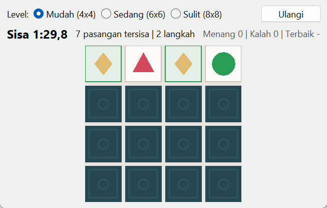
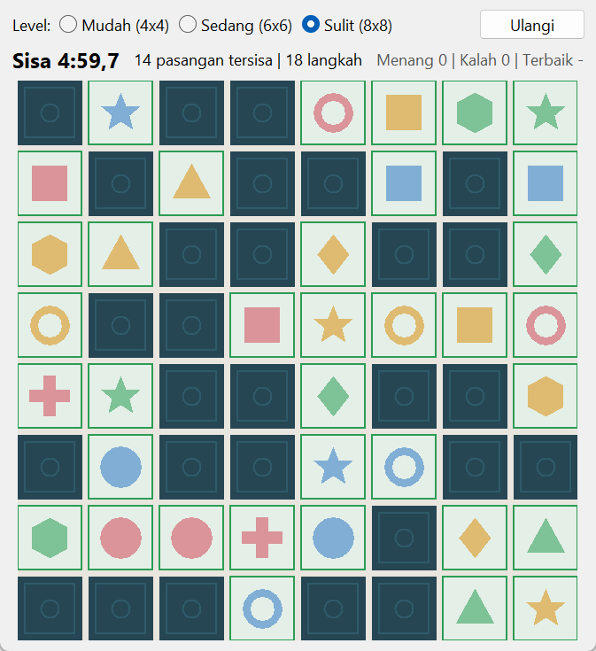

# Card Memory Game

Buka dua kartu dan cari pasangan gambarnya sebelum waktu habis. Spesifikasi: [Card Memory Game](https://github.com/florinpop17/app-ideas/blob/master/Projects/2-Intermediate/Card-Memory-Game.md).

Jendela Tkinter, hanya pustaka bawaan Python.



## Menjalankan

```bash
python memory_game.py
```

1. Pilih level, lalu tekan **Mulai**. Timer baru berjalan setelah tombol ini ditekan.
2. Klik kartu untuk membukanya, lalu klik kartu kedua.
   - **Cocok:** kedua kartu tetap terbuka, dipudarkan, dan diberi garis hijau.
   - **Tidak cocok:** kedua kartu terlihat sebentar (0,8 detik) lalu tertutup lagi. Kalau kamu langsung mengklik kartu lain, keduanya langsung ditutup.
3. Kalau semua pasangan ditemukan, muncul kotak dialog ucapan selamat berisi lama bermain dan jumlah langkah. Kalau waktu habis, permainan dihitung kalah.

| Level | Grid | Pasangan | Batas waktu |
| --- | --- | --- | --- |
| Mudah | 4×4 | 8 | 1:30 |
| Sedang | 6×6 | 18 | 3:00 |
| Sulit | 8×8 | 32 | 5:00 |

Makin sulit, kartunya makin banyak dan waktu per pasangan makin sedikit (11,25 → 10 → 9,375 detik).



## Gambar kartu

Gambarnya bentuk geometri yang digambar langsung di Canvas: 8 bentuk × 4 warna = 32 gambar berbeda. Tidak ada berkas gambar yang perlu diunduh, dan Tk 8.6 di Windows memang kurang andal menampilkan emoji berwarna.

Bentuk selalu dipakai sebagai pembeda pertama. Di level Mudah (8 pasangan), semua kartu punya bentuk berbeda, jadi permainan tetap bisa dimainkan oleh orang yang sulit membedakan warna. Warna baru menjadi pembeda tambahan di level Sedang dan Sulit.

## Statistik

Jumlah menang, kalah, dan waktu terbaik per level tampil di kanan atas, dan disimpan di `~/.app-ideas-python/memory-stats.json`. Permainan yang ditinggalkan di tengah jalan (menekan **Ulangi** atau berganti level) tidak dihitung sebagai kalah.

## Tes

```bash
python -m unittest -v
```

Logika permainan (kelas `MemoryGame` dan `Stats`) terpisah dari jendela Tkinter. Jam bisa diganti dengan jam tiruan, jadi tes kalah karena waktu habis tidak perlu menunggu 90 detik.

## Pemetaan user stories

- [x] Grid n × n kartu, semuanya tertutup di awal
- [x] Tombol untuk memulai permainan sekaligus menyalakan timer
- [x] Klik kartu untuk membukanya; gambar tetap terlihat sampai kartu kedua diklik
- [x] Cocok: kedua kartu tetap terbuka dan ditandai
- [x] Tidak cocok: kedua kartu kembali tertutup
- [x] Dialog ucapan selamat berisi lama bermain setelah semua pasangan ditemukan
- [x] Bonus: tiga level (Mudah, Sedang, Sulit) dengan kartu lebih banyak dan waktu per pasangan lebih sedikit
- [x] Bonus: statistik menang/kalah dan waktu terbaik per level
