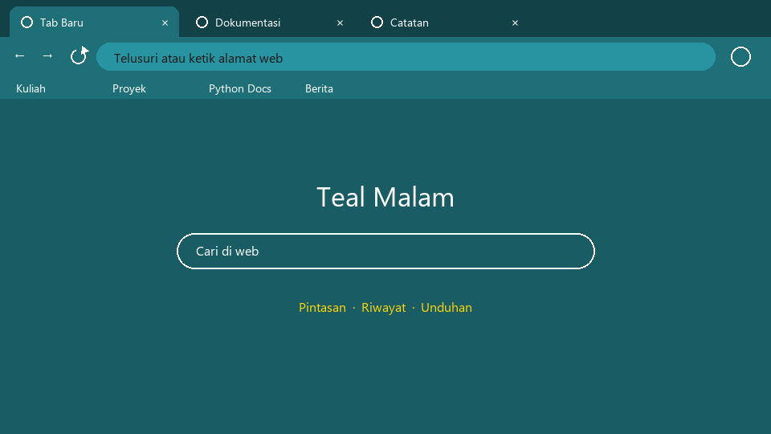
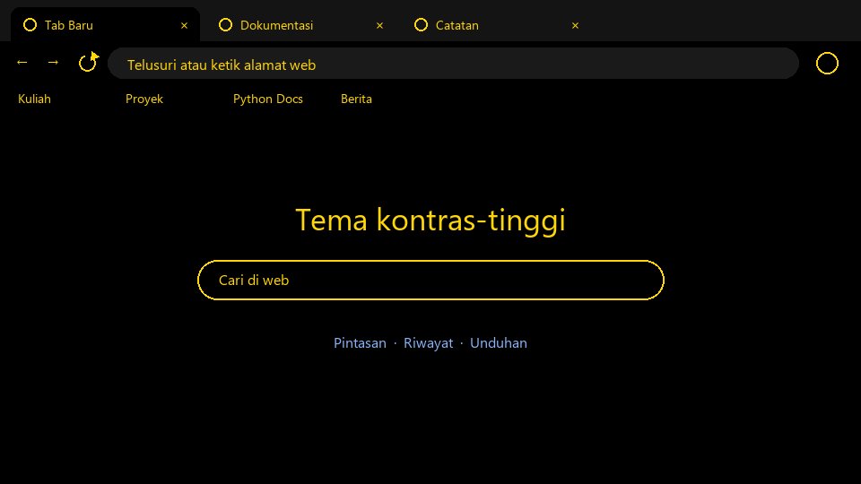

# Chrome Theme Extension

Generator tema Chrome (dan Firefox) dari warna pilihan sendiri. Spesifikasi: [Chrome Theme Extension](https://github.com/florinpop17/app-ideas/blob/master/Projects/2-Intermediate/Chrome-Theme-Extension.md).

Tema Chrome tidak berisi kode, hanya berkas `manifest.json` berisi warna. Program Python ini menyusun berkas itu untukmu:

1. **Palet:** dari satu warna dasar, program menurunkan warna bingkai jendela, toolbar, bilah alamat, dan halaman tab baru.
2. **Warna teks:** dipilih otomatis (gelap atau putih) supaya kontrasnya memenuhi WCAG AA, minimal 4.5:1. Setiap pasangan teks dan latar dilaporkan. Ini bagian dari user story untuk penderita buta warna dan gangguan penglihatan, ditambah preset kontras tinggi dan palet Okabe-Ito.
3. **Berkas:** program menulis folder ekstensi yang siap dipasang dan gambar pratinjau, lalu kalau diminta juga versi Firefox dan berkas zip untuk diunggah ke toko ekstensi.

Butuh `pillow` untuk gambar pratinjau (`pip install pillow`). Selain itu hanya pustaka bawaan.



## Menjalankan

```bash
python chrome_theme.py --base "#1f6f78" --name "Teal Malam" -o tema-teal
python chrome_theme.py --preset kontras-tinggi -o tema-kontras --firefox --zip
python chrome_theme.py --base "#f4efe6" --text "#3a3a3a" -o tema-krem    # warna teks sendiri
python chrome_theme.py --base "#777777" --text "#888888" --strict        # gagal: kontras kurang
python chrome_theme.py --list-presets
```

Pilihan lain: `--frame`, `--ntp` (latar tab baru), dan `--accent` (warna tautan) untuk menimpa warna turunan, serta `--no-preview`.

Keluaran `python chrome_theme.py --base "#1f6f78" --name "Teal Malam" -o tema-teal --firefox --zip`:

```
Kontras teks (minimal WCAG AA 4.5:1):
  OK    Teks tab aktif          5.83:1
  OK    Teks tab tidak aktif   11.08:1
  OK    Teks bookmark           5.83:1
  OK    Teks bilah alamat       4.84:1
  OK    Teks tab baru           7.61:1
  OK    Tautan tab baru         5.39:1

Tema Chrome: tema-teal\chrome
  Pasang: buka chrome://extensions, nyalakan Developer mode, klik 'Load unpacked', pilih folder itu.
Tema Firefox: tema-teal\firefox
  Pasang sementara: buka about:debugging > This Firefox > 'Load Temporary Add-on', pilih manifest.json.
Zip Chrome Web Store: tema-teal\teal-malam-chrome.zip
Zip Firefox Add-ons: tema-teal\teal-malam-firefox.zip
Pratinjau: tema-teal\preview.png
```

## Memasang tema

- **Chrome:** buka `chrome://extensions`, nyalakan **Developer mode**, klik **Load unpacked**, lalu pilih folder `chrome/`. Tema langsung aktif dan menjadi tema bawaan. Untuk kembali ke tema asli, buka Settings > Appearance > Reset to default.
- **Firefox:** buka `about:debugging` > This Firefox > **Load Temporary Add-on**, lalu pilih `firefox/manifest.json`. Tema sementara hilang saat Firefox ditutup. Untuk pemasangan permanen, unggah zip-nya ke addons.mozilla.org supaya ditandatangani.
- **Chrome Web Store:** unggah `*-chrome.zip` lewat Developer Dashboard (butuh akun developer berbayar sekali).

## Preset

| Preset | Warna dasar | Keterangan |
| --- | --- | --- |
| `kontras-tinggi` | `#000000` | Hitam dan kuning, kontras sangat tinggi |
| `okabe-biru` | `#0072b2` | Biru Okabe-Ito, aman untuk buta warna merah-hijau |
| `okabe-oranye` | `#e69f00` | Oranye Okabe-Ito, aman untuk buta warna merah-hijau |
| `sepia-malam` | `#3b2f2a` | Cokelat hangat yang redup untuk malam hari |
| `gelap` | `#2b2b2e` | Abu-abu gelap netral |
| `terang` | `#eceef1` | Abu-abu terang netral |



## Soal kontras

Kontras dihitung dengan rumus WCAG 2.x (luminans relatif). Untuk latar berkecerahan sedang, teks abu-abu tua `#1a1a1a` bisa kurang dari 4.5:1, misalnya di atas hijau `#00cc00`. Dalam kasus itu program memakai hitam murni. Teks yang dipilih otomatis selalu lulus, karena kontras sebuah warna terhadap hitam dikali kontrasnya terhadap putih selalu 21, jadi salah satunya pasti minimal √21 ≈ 4.58. Tes memeriksa ini untuk 216 warna dasar.

Kalau kamu menimpa warna teks sendiri dan kontrasnya kurang, program memberi peringatan. Dengan `--strict`, program menolak membuat tema.

## Yang sudah diverifikasi

- **Chrome:** keenam preset dan tema contoh dibungkus dengan `chrome.exe --pack-extension`, dan semuanya berhasil menjadi `.crx`. Chrome memeriksa manifest saat membungkus. Manifest tanpa `version` ditolak ("Required value 'version' is missing"), begitu juga warna berupa teks ("colors must be integers").
- **Firefox:** manifest mengikuti daftar kunci tema di dokumentasi MDN, tetapi belum dicoba dipasang di Firefox.
- **Night light:** fitur filter cahaya biru yang disebut di pengantar spesifikasi tidak dibuat. Fitur itu butuh ekstensi biasa berisi JavaScript, bukan tema.

## Tes

```bash
python -m unittest -v
```

## Pemetaan user stories

- [x] Membuat tema sesuai warna pilihan sendiri (`--base`, `--frame`, `--text`, `--ntp`, `--accent`, atau preset)
- [x] Bermanfaat untuk penderita buta warna: kontras teks dijamin dan dilaporkan, ada preset kontras tinggi dan Okabe-Ito
- [x] Bisa dipasang dan dijadikan tema bawaan (Load unpacked)
- [ ] Bonus: terbit di Chrome Web Store. Zip-nya sudah siap, tetapi penerbitan butuh akun developer milikmu sendiri.
- [ ] Bonus: tombol untuk menyalakan night sight secara manual (tidak dibuat, lihat di atas)
- [x] Bonus: versi untuk browser lain (Firefox, `--firefox`)
