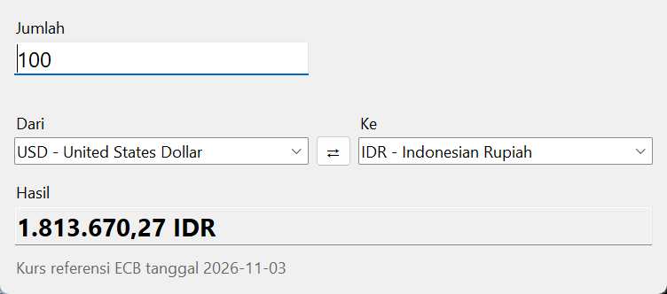
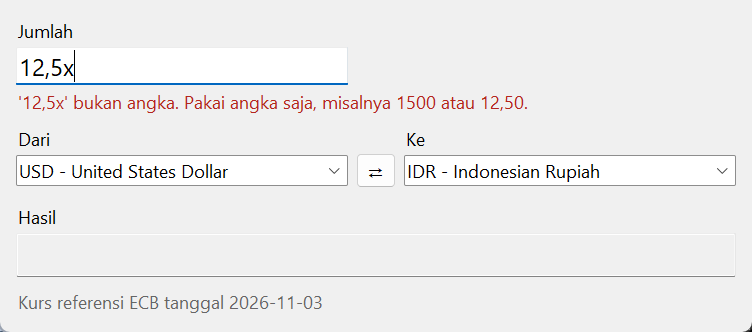

# Currency Converter

Konversi mata uang dengan kurs referensi Bank Sentral Eropa (ECB). Spesifikasi: [Currency Converter](https://github.com/florinpop17/app-ideas/blob/master/Projects/2-Intermediate/Currency-Converter.md).

Kurs diambil dari [Frankfurter API](https://frankfurter.dev), yang gratis dan tanpa kunci. Tampilannya jendela Tkinter, dan ada juga mode baris perintah. Hanya pustaka bawaan Python.



## Menjalankan

```bash
python currency.py                  # jendela
python currency.py 100 USD IDR      # sekali hitung di terminal
python currency.py --list           # daftar mata uang
```

Di jendela, hasil langsung dihitung ulang setiap kali jumlah diketik atau mata uang asal/tujuan diganti. Tombol **⇄** menukar mata uang asal dan tujuan.

Contoh di terminal (kurs 3 November 2026):

```
$ python currency.py 100 USD IDR
100,00 USD = 1.813.670,27 IDR (kurs ECB 2026-11-03)

$ python currency.py 1234567,89 IDR JPY
1.234.567,89 IDR = 10.774,68 JPY (kurs ECB 2026-11-03)
```

## Aturan input

- Maksimal 9 digit, misalnya `999999999` atau `9999999,99`.
- Pemisah desimal boleh titik atau koma, maksimal 2 angka di belakangnya. Pemisah ribuan tidak dipakai, jadi `1,000` ditolak (tiga angka di belakang koma) supaya tidak disalahartikan sebagai seribu.
- Yang bukan angka ditolak dengan pesan merah di bawah kotak isian dan bunyi peringatan. Angka non-ASCII seperti `١٢` juga ditolak. Kotak kosong saat mengetik ulang tidak dianggap kesalahan.



## Cara menghitung

Frankfurter memberikan kurs dalam EUR (1 EUR = 1,1179 USD = 20.275,02 IDR). Kurs silang dihitung dengan `Decimal`, bukan `float`:

```
100 USD → IDR = 100 / 1,1179 × 20.275,02 = 1.813.670,27
```

Hasilnya dibulatkan ke 2 desimal (setengah ke atas) dan ditampilkan dengan format Indonesia (`1.813.670,27`).

Kurs ECB diperbarui sekali sehari pada hari kerja. Kurs terakhir disimpan di `~/.app-ideas-python/rates.json`. Kalau tidak ada internet, program memakai kurs tersimpan itu dan menandainya dengan "offline".

## Tes

```bash
python -m unittest -v
```

Tes memakai respons API tiruan. Tes jendela (hasil langsung berubah, peringatan, tombol tukar) membuka Tk tanpa menampilkan jendela, dan dilewati kalau Tk tidak tersedia.

## Pemetaan user stories

- [x] Kotak isian jumlah, maksimal 9 digit
- [x] Daftar mata uang asal yang terurut
- [x] Daftar mata uang tujuan yang terurut
- [x] Hasil (2 desimal) langsung berubah saat jumlah, mata uang asal, atau mata uang tujuan diganti
- [x] Peringatan kalau input bukan angka
- [x] Bonus: tombol untuk menukar mata uang asal dan tujuan
