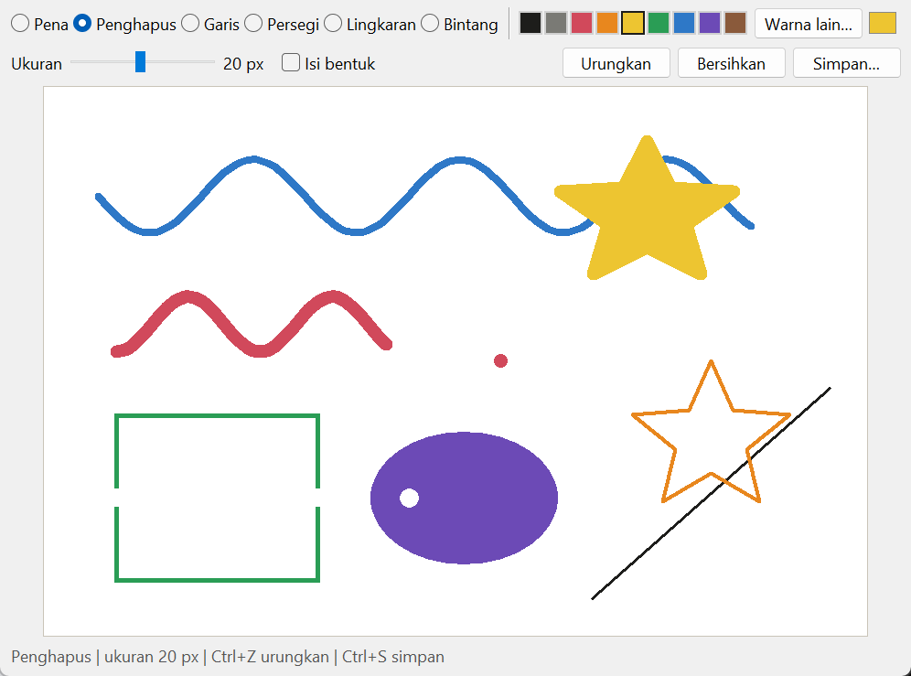
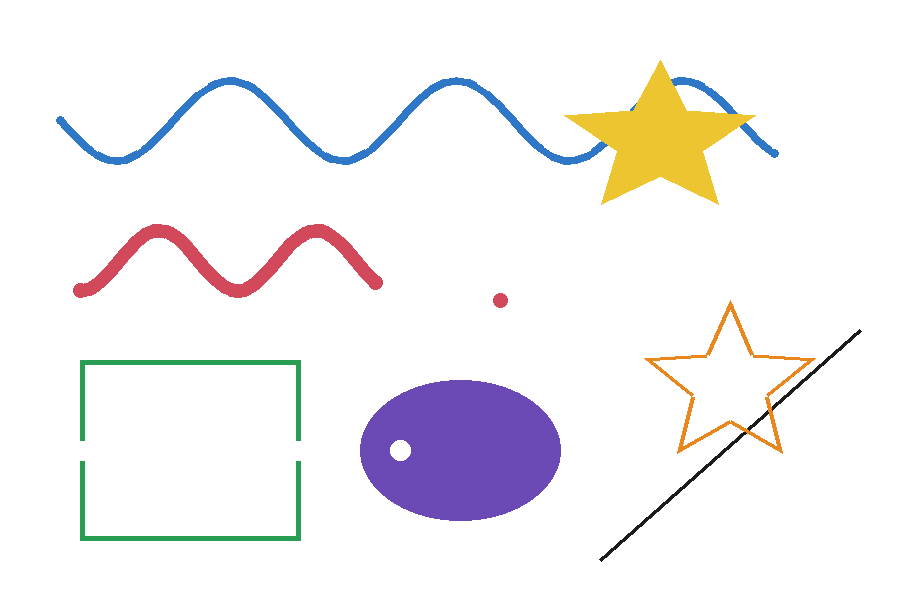

# Drawing App

Menggambar dengan mouse di jendela Tkinter, lalu menyimpannya sebagai PNG atau JPG. Spesifikasi: [Drawing App](https://github.com/florinpop17/app-ideas/blob/master/Projects/2-Intermediate/Drawing-App.md).

Butuh `pillow` untuk menyimpan gambar (`pip install pillow`).



## Menjalankan

```bash
python drawing_app.py
```

- **Alat:** Pena, Penghapus, Garis, Persegi, Lingkaran, dan Bintang. Bentuk digambar dengan menekan lalu menyeret mouse, dan pratinjaunya mengikuti mouse sampai tombol dilepas.
- **Warna:** pilih dari 9 kotak warna, atau dari pemilih warna lengkap lewat **Warna lain…**. Memilih warna saat memakai penghapus akan kembali ke pena.
- **Ukuran:** penggeser 1–40 px, berlaku untuk pena, penghapus, dan garis tepi bentuk.
- **Isi bentuk:** persegi, lingkaran, dan bintang diisi warna penuh, bukan hanya garis tepinya.
- **Urungkan** (`Ctrl+Z`), **Bersihkan**, dan **Simpan…** (`Ctrl+S`). Bersihkan juga bisa diurungkan.

## Cara menyimpan

Canvas Tkinter hanya bisa diekspor ke PostScript, bukan PNG. Karena itu setiap goresan dan bentuk juga disimpan sebagai data (kelas `Drawing`: jenis, titik, warna, ukuran, terisi atau tidak). Saat disimpan, data itu digambar ulang dengan Pillow. Data yang sama dipakai untuk fitur urungkan.

Gambar di bawah adalah berkas PNG hasil **Simpan…** dari jendela di atas. Isinya sama dengan yang tampil di layar, termasuk bekas penghapus yang melintasi persegi hijau.



Penghapus menggambar dengan warna latar (putih). Karena itu hasil PNG dan JPG selalu berlatar putih, bukan transparan.

## Tes

```bash
python -m unittest -v
```

Tes memeriksa piksel hasil render Pillow (garis tepi vs isi, ujung goresan yang bulat, penghapus). Tes jendela memakai event mouse tiruan dan dilewati kalau Tk tidak tersedia.

## Pemetaan user stories

- [x] Menggambar di canvas dengan mouse
- [x] Mengganti warna
- [x] Mengganti ukuran alat
- [x] Tombol untuk membersihkan canvas
- [x] Bonus: menyimpan karya sebagai gambar (`.png`, `.jpg`)
- [x] Bonus: menggambar bentuk (garis, persegi, lingkaran, bintang)
- [ ] Bonus: membagikan ke media sosial (tidak dibuat; simpan dulu sebagai PNG lalu unggah sendiri)
