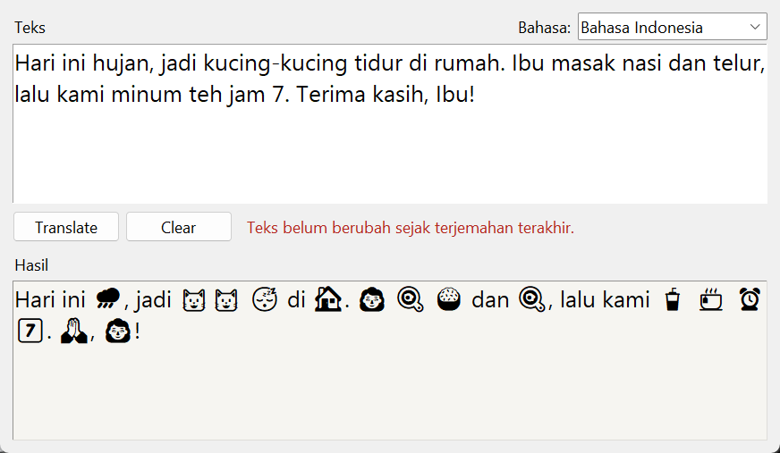

# Emoji Translator

Mengubah kata-kata dalam kalimat menjadi emoji. Spesifikasi: [Emoji Translator App](https://github.com/florinpop17/app-ideas/blob/master/Projects/2-Intermediate/Emoji-Translator-App.md).

Jendela Tkinter, plus mode terminal. Hanya pustaka bawaan Python.



## Menjalankan

```bash
python emoji_translator.py                                # jendela
python emoji_translator.py "saya suka kucing dan kopi"    # terminal
python emoji_translator.py --lang en "i love pizza"
```

Contoh di terminal:

```
$ python emoji_translator.py "Ibu ke rumah sakit naik kereta api jam 7."
👩 ke 🏥 naik 🚆 ⏰ 7️⃣.

$ python emoji_translator.py "Kucing-kucing tidur di rumahnya."
🐱🐱 😴 di 🏠nya.

$ python emoji_translator.py --lang en "I love pizza, hot dogs and cats."
I ❤️ 🍕, 🌭 and 🐱.
```

Di jendela, tekan **Translate** (atau `Ctrl+Enter`) untuk menerjemahkan dan **Clear** untuk mengosongkan kedua kotak. Peringatan merah muncul kalau kotak teks kosong atau teksnya belum berubah sejak terjemahan terakhir. Mengganti bahasa dihitung sebagai perubahan.

## Kamus

Kamusnya ditulis sendiri: 151 emoji, dengan 278 kata/frasa bahasa Indonesia dan 300 bahasa Inggris. Setiap emoji punya beberapa sinonim, misalnya 🐱 untuk `kucing`, `meong`, dan `kitten`, atau 😂 untuk `tertawa`, `ketawa`, `ngakak`, dan `lucu`. Tes memastikan tidak ada kata yang menunjuk ke dua emoji berbeda.

Aturan tambahan:

- **Frasa:** frasa dicocokkan lebih dulu, sampai 3 kata. `rumah sakit` menjadi 🏥, bukan 🏠 🤒. Frasa yang terpotong tanda baca (`rumah, sakit`) tidak digabung.
- **Bentuk ulang (Indonesia):** `kucing-kucing` menjadi 🐱🐱.
- **Akhiran `-nya`, `-ku`, `-mu` (Indonesia):** `rumahnya` menjadi 🏠nya. Kata yang ada di kamus dicek lebih dulu, jadi `buku` tetap 📚 dan `kamu` tidak dipecah.
- **Jamak `-s`/`-es` (Inggris):** `cats` menjadi 🐱 dan `hot dogs` menjadi 🌭.
- **Angka:** angka menjadi emoji keycap, misalnya `7` → 7️⃣ dan `2026` → 2️⃣0️⃣2️⃣6️⃣.
- **Kata lain:** kata yang tidak ada di kamus, tanda baca, dan spasi dibiarkan apa adanya.

## Catatan tampilan

Tk 8.6 di Windows menampilkan emoji dalam hitam-putih: warna kulit hilang, dan bendera 🇮🇩 tampil sebagai huruf "ID". Teks yang dihasilkan tetap emoji yang benar. Kalau disalin dari kotak hasil atau dijalankan di terminal (Windows Terminal), emojinya tampil berwarna.

## Tes

```bash
python -m unittest -v
```

## Pemetaan user stories

- [x] Kotak teks untuk kata, angka, dan tanda baca
- [x] Tombol Translate untuk mengubah kata menjadi emoji
- [x] Peringatan kalau Translate ditekan saat kotak kosong atau teks belum berubah
- [x] Hasil di kotak keluaran; kata tanpa emoji dibiarkan
- [x] Tombol Clear untuk mengosongkan kotak masukan dan keluaran
- [x] Bonus: sinonim, supaya lebih banyak kata bisa diterjemahkan
- [x] Bonus: pilihan bahasa masukan (Bahasa Indonesia atau English)
