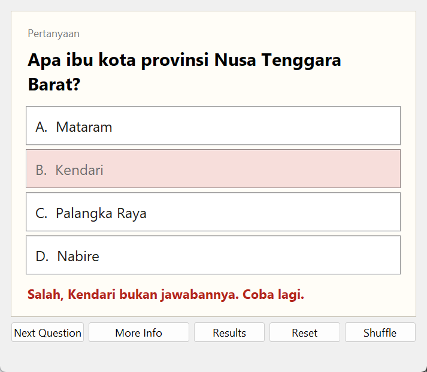
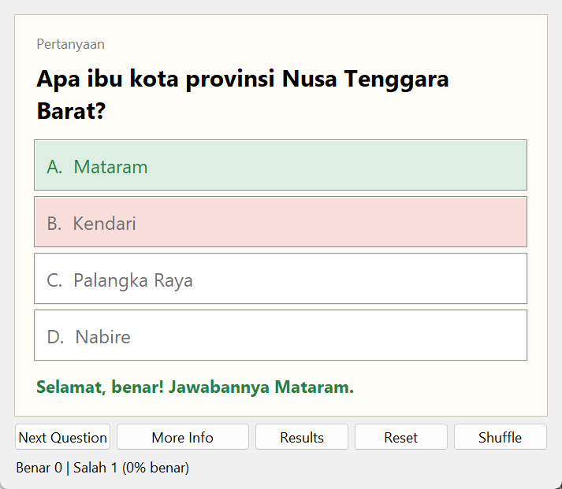
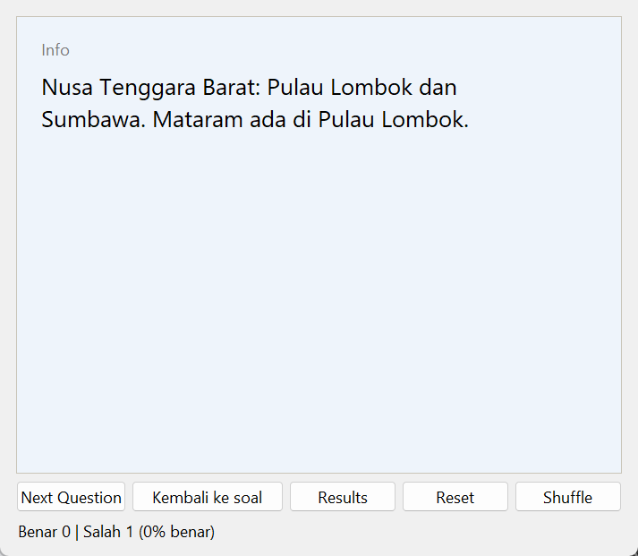

# Flashcards

Kartu soal pilihan ganda. Jawaban salahnya diambil acak dari jawaban kartu lain. Spesifikasi: [Flashcards App](https://github.com/florinpop17/app-ideas/blob/master/Projects/2-Intermediate/FlashCards-App.md).

Jendela Tkinter, hanya pustaka bawaan Python.

| Jawaban salah | Jawaban benar | Sisi belakang (More Info) |
| --- | --- | --- |
|  |  |  |

## Menjalankan

```bash
python flashcards.py
python flashcards.py --deck deck-saya.json
```

- Klik jawaban, atau tekan `A`–`D`. Jawaban salah ditandai merah dan bisa dicoba lagi. Jawaban benar ditandai hijau dengan ucapan selamat.
- **Next Question** (atau `Enter`) menampilkan kartu berikutnya.
- **More Info** membalik kartu ke sisi belakang yang berisi info tambahan. Tekan **Kembali ke soal** untuk kembali.
- **Results** menampilkan jumlah jawaban benar dan salah, **Reset** mengembalikannya ke nol, dan **Shuffle** mengocok ulang deck.

## Deck

Basis pengetahuannya berupa dict Python, karena spesifikasi meminta objek JavaScript: ibu kota 37 provinsi Indonesia, beserta info singkat letaknya. Info itu muncul di sisi belakang kartu, misalnya "Ibu kota pindah dari Banjarmasin ke Banjarbaru pada 2022". DKI Jakarta tidak dimasukkan karena tidak punya ibu kota provinsi seperti provinsi lain.

Deck lain bisa dimuat dari JSON:

```json
[
  {"question": "Fungsi bawaan untuk panjang list?", "answer": "len()", "info": "len([1, 2, 3]) == 3"},
  {"question": "Kata kunci untuk membuat fungsi?", "answer": "def"},
  ...
]
```

Deck butuh setidaknya 4 jawaban berbeda.

## Aturan

- **Urutan kartu:** acak, dan setiap kartu muncul sekali sebelum deck dikocok lagi. Kartu yang sama tidak pernah muncul dua kali berturut-turut, termasuk saat deck dikocok ulang.
- **Pilihan jawaban:** empat pilihan berhuruf A–D. Tiga pilihan salahnya diambil acak dari jawaban kartu lain, dan posisi jawaban benar juga acak.
- **Hitungan:** dicatat sekali per kartu, dari pilihan pertama. Salah dulu lalu benar dihitung sebagai satu jawaban salah.

## Tes

```bash
python -m unittest -v
```

## Pemetaan user stories

- [x] Satu kartu tampil pada satu waktu, dipilih acak dari deck
- [x] Pertanyaan dengan empat pilihan jawaban berhuruf
- [x] Memilih jawaban dengan mengklik
- [x] Pesan kesalahan saat jawaban salah dipilih
- [x] Ucapan selamat saat jawaban benar dipilih
- [x] Tombol Next Question
- [x] Basis pengetahuan dalam bentuk objek (dict Python), dan pilihan jawaban diambil acak dari kartu lain
- [x] Bonus: tombol Results
- [x] Bonus: tombol Reset
- [x] Bonus: tombol Shuffle
- [x] Bonus: tombol More Info untuk membalik kartu
