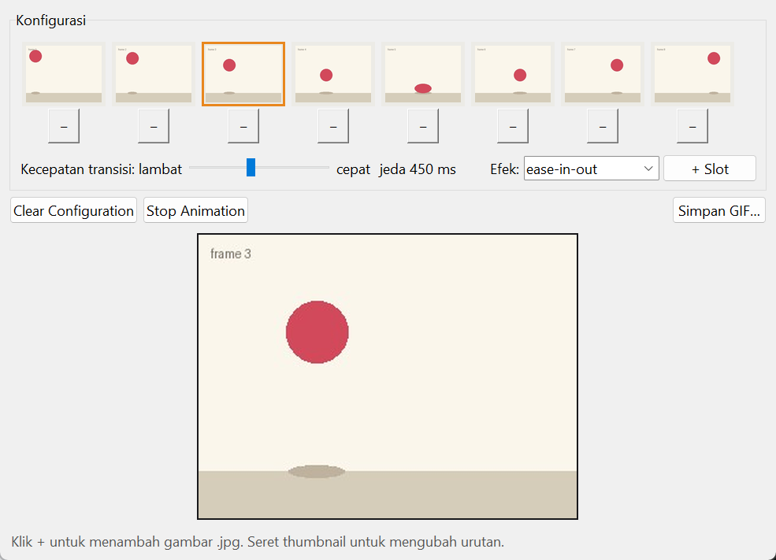
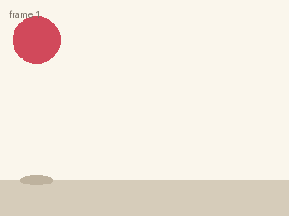

# Flip Art

Menyusun beberapa gambar menjadi animasi, lalu mengatur kecepatan dan efek transisinya. Spesifikasi: [Flip Art App](https://github.com/florinpop17/app-ideas/blob/master/Projects/2-Intermediate/Flip-Art-App.md).

Jendela Tkinter. Butuh `pillow` (`pip install pillow`) untuk membuka JPG dan menyimpan GIF.



GIF di bawah ini dibuat dengan **Simpan GIF…** dari 8 frame contoh, kecepatan 5 (jeda 450 ms), efek `ease-in-out`:



## Menjalankan

```bash
python flip_art.py          # 8 slot kosong
python flip_art.py --demo   # slot diisi 8 frame contoh (bola memantul)
```

**Konfigurasi**

- **Menambah gambar:** klik **+** di bawah thumbnail untuk memilih gambar `.jpg` (PNG, GIF, dan BMP juga bisa). Setelah terisi, tombolnya berubah menjadi **−** untuk menghapus gambar itu. Klik **+** lagi untuk menggantinya.
- **Mengubah urutan:** seret sebuah thumbnail ke thumbnail lain.
- **+ Slot:** menambah slot di luar delapan slot awal.
- **Kecepatan transisi:** dari 1 (lambat, jeda 1500 ms) sampai 10 (cepat, jeda 100 ms).
- **Efek:** `none`, `linear`, `ease`, `ease-in`, `ease-out`, atau `ease-in-out`.

**Tombol operasi**

- **Start Animation:** nonaktif sampai ada minimal satu gambar. Setelah ditekan, labelnya berubah menjadi **Stop Animation**, dan kembali menjadi **Start Animation** saat animasi dihentikan.
- **Clear Configuration:** mengosongkan semua slot.
- **Simpan GIF…:** menyimpan animasi sebagai GIF yang berulang terus.

**Panel animasi**

- Gambar ditampilkan bergantian mengikuti kecepatan dan efek yang dipilih.
- Thumbnail yang sedang tampil diberi bingkai oranye.

## Cara kerja animasi

Spesifikasi meminta animasi dibuat tanpa library animasi, jadi semuanya ditulis sendiri:

- **Penjadwalan:** `after()` milik Tkinter menjadwalkan setiap langkah animasi.
- **Jeda per frame:** dengan efek transisi, frame tampil penuh selama separuh pertama jeda. Separuh kedua dipakai untuk crossfade ke frame berikutnya, dengan langkah 40 ms. Tanpa transisi (`none`), frame tampil penuh selama seluruh jeda.
- **Kurva easing:** dihitung dari definisi `cubic-bezier` CSS. `ease` adalah `cubic-bezier(0.25, 0.1, 0.25, 1)`, `ease-in-out` adalah `cubic-bezier(0.42, 0, 0.58, 1)`, dan seterusnya. Fungsi `cubic_bezier()` mencari titik pada kurva dengan bisection. Tes mencocokkan hasilnya dengan nilai acuan CSS: `ease` di t = 0,5 menghasilkan sekitar 0,8024.
- **Pillow:** hanya dipakai untuk membuka dan mengubah ukuran gambar, mencampur dua frame (`Image.blend`), dan menulis GIF.

Saat disimpan, Pillow menggabungkan frame GIF berurutan yang sama persis. Karena itu GIF contoh berisi 49 frame, padahal animasinya terdiri dari 56 langkah.

## Bunyi

Di Windows, menambah, menghapus, memindah, dan mengosongkan gambar masing-masing berbunyi beda (`winsound.MessageBeep`). Di sistem lain tidak ada bunyi.

## Tes

```bash
python -m unittest -v
```

## Pemetaan user stories

- [x] Panel konfigurasi, tombol operasi, dan panel tampilan animasi
- [x] Delapan thumbnail, masing-masing dengan tombol **+**
- [x] **+** membuka dialog untuk memilih gambar `.jpg`
- [x] Label **+** berubah menjadi **−** setelah thumbnail terisi; **−** menghapus atau mengganti gambar
- [x] Slider kecepatan transisi dari lambat ke cepat
- [x] Tombol Clear Configuration dan Start Animation
- [x] Start Animation nonaktif sampai ada minimal satu thumbnail
- [x] Label berganti antara Start Animation dan Stop Animation
- [x] Thumbnail tampil bergantian di panel animasi mengikuti kecepatan slider
- [x] Bonus: bingkai thumbnail yang sedang tampil disorot
- [x] Bonus: jumlah thumbnail bisa ditambah (**+ Slot**)
- [x] Bonus: bunyi berbeda saat mengubah thumbnail (Windows)
- [x] Bonus: pilihan efek transisi `ease`, `ease-in`, `ease-out`, `ease-in-out`
- [x] Bonus: seret thumbnail untuk mengubah urutan
- [x] Bonus: menyimpan animasi sebagai `.gif`
