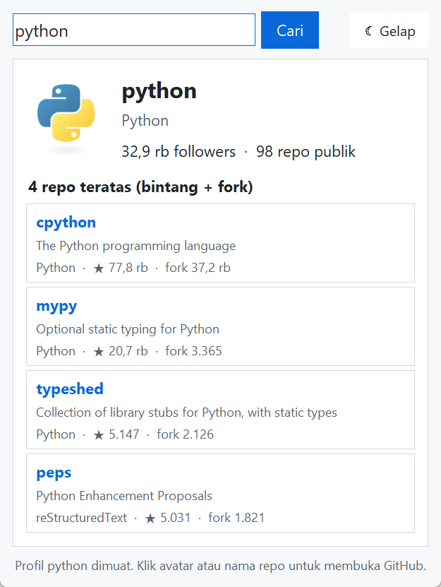
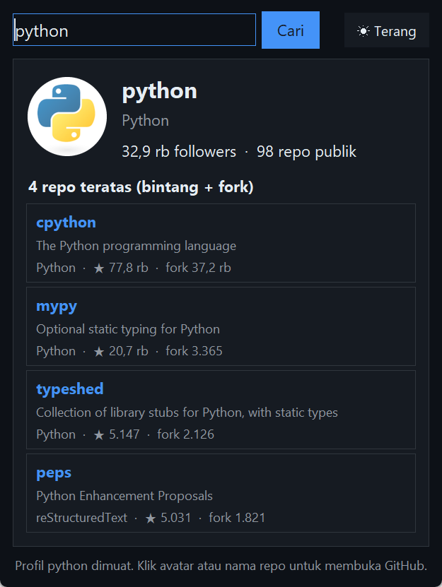

# GitHub Profiles

Mencari pengguna GitHub, lalu menampilkan avatar, username, jumlah followers dan repo, serta 4 repo teratas. Spesifikasi: [GitHub Profiles](https://github.com/florinpop17/app-ideas/blob/master/Projects/2-Intermediate/GitHub-Profiles.md).

Jendela Tkinter, plus mode terminal. Butuh `pillow` untuk avatar (`pip install pillow`).

| Mode terang | Mode gelap |
| --- | --- |
|  |  |

## Menjalankan

```bash
python github_profiles.py            # jendela
python github_profiles.py python     # terminal
```

Di jendela, ketik username lalu tekan **Cari** atau `Enter`. Klik avatar untuk membuka profil di GitHub, atau klik nama repo untuk membuka repo itu. Tombol di kanan atas mengganti mode gelap/terang. Pilihan itu disimpan di `~/.app-ideas-python/github-profiles.json`, jadi tetap sama saat aplikasi dibuka lagi.

Keluaran `python github_profiles.py python` (4 November 2026):

```
python (Python)
Followers: 32,9 rb | Repo publik: 98
https://github.com/python

4 repo teratas (bintang + fork):
  1. cpython [Python]  ★ 77,8 rb  fork 37,2 rb
  2. mypy [Python]  ★ 20,7 rb  fork 3.365
  3. typeshed [Python]  ★ 5.147  fork 2.126
  4. peps [reStructuredText]  ★ 5.031  fork 1.821
```

## Repo teratas

Repo diurutkan berdasarkan jumlah bintang + fork, karena spesifikasi menyebut "top 4 repositories based on forks and stars". Kalau jumlahnya sama, repo dengan bintang lebih banyak didahulukan. Repo hasil fork dari orang lain tidak dihitung. Daftar repo diambil per halaman (100 repo per halaman, sampai 300 repo).

## Peringatan

Peringatan muncul untuk:

- **Username tidak valid:** dicek sebelum mengirim permintaan. Username GitHub hanya boleh berisi huruf, angka, dan tanda hubung tunggal yang tidak berada di awal atau akhir, dengan panjang maksimal 39 karakter.
- **Pengguna tidak ditemukan:** GitHub menjawab 404.
- **Batas permintaan habis:** tanpa login, API GitHub hanya mengizinkan 60 permintaan per jam per alamat IP. Pesan peringatannya menyebut perkiraan menit sampai batas itu pulih. Setiap pencarian memakai 2 permintaan (profil + repo). Kalau variabel lingkungan `GITHUB_TOKEN` diisi, token itu dipakai supaya batasnya jadi 5.000 per jam.
- **Tidak ada koneksi internet.**

Di terminal, username yang diawali tanda hubung perlu ditulis setelah `--`, misalnya `python github_profiles.py -- -bad-`.

## Tes

```bash
python -m unittest -v
```

Tes memakai API GitHub tiruan, termasuk daftar repo berhalaman, jawaban 404, dan batas permintaan.

## Pemetaan user stories

- [x] Memasukkan username
- [x] Tombol cari untuk mengambil informasi
- [x] Avatar, username, jumlah followers, dan jumlah repo
- [x] 4 repo teratas
- [x] Peringatan kalau username tidak valid
- [x] Bonus: tombol mode gelap/terang
- [x] Bonus: mode yang dipilih tetap tersimpan saat aplikasi dibuka lagi
