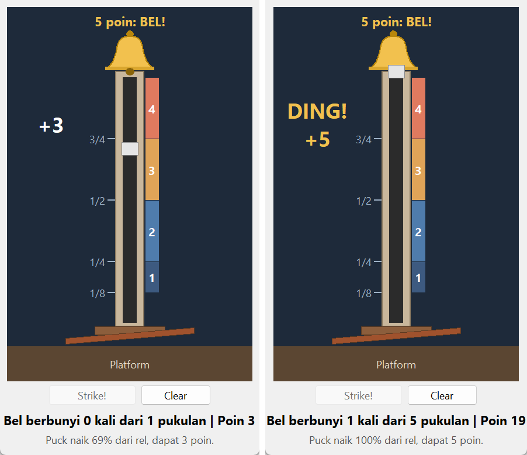

# HighStriker

Simulasi permainan palu karnaval: pukul platform, lihat puck naik di rel, dan coba bunyikan bel di puncak. Spesifikasi: [HighStriker Game](https://github.com/florinpop17/app-ideas/blob/master/Projects/2-Intermediate/HighStriker-Game.md).

Jendela Tkinter, hanya pustaka bawaan Python.



## Menjalankan

```bash
python highstriker.py
```

Tekan **Strike!** (atau `Spasi`) untuk memukul. **Clear** membersihkan skor. Setelah total 10 poin terkumpul, muncul ucapan selamat beserta jumlah pukulan yang dibutuhkan.

## Algoritma pukulan

Spesifikasi meminta algoritma rancangan sendiri ditambah angka acak:

1. **Kekuatan:** kekuatan pukulan `s` diambil dari distribusi normal dengan rata-rata 0,82 dan simpangan 0,2, lalu dibatasi ke rentang 0,15–1,3.
2. **Tinggi:** seperti benda yang dilempar ke atas, tinggi maksimum sebanding dengan kuadrat kecepatan awal. Jadi puck naik sampai `s²` dari tinggi rel. Bel berbunyi kalau `s ≥ 1`.
3. **Gerakan:** puck naik dengan perlambatan tetap, `h(t) = s² · (1 − (1 − t/T)²)`. Waktu naik `T` sebanding dengan `s`. Kalau puck menyentuh bel sebelum mencapai puncaknya, ia memantul. Setelah itu puck jatuh bebas kembali ke platform.

Dari 100.000 pukulan simulasi (seed 0), bel berbunyi 18,5% dan rata-rata skornya 3,2 poin. Karena itu 10 poin biasanya tercapai dalam 3–4 pukulan.

| Jarak tempuh | Poin |
| --- | --- |
| < 1/8 | 0 |
| 1/8 – 1/4 | 1 |
| 1/4 – 1/2 | 2 |
| 1/2 – 3/4 | 3 |
| 3/4 – bawah bel | 4 |
| Bel berbunyi | 5 |

## Bunyi dan getaran

Semua bunyi dibuat sendiri sebagai berkas WAV dengan modul `wave` saat program dimulai, lalu diputar dengan `winsound` (Windows):

- **Bel:** empat nada parsial dengan rasio khas lonceng yang meredup selama 1,6 detik.
- **Puck naik di rel:** nada pendek yang makin tinggi.
- **Poin 0–4:** nada yang berbeda untuk setiap jumlah poin. Poin 5 memakai bunyi bel.

Saat bel berbunyi, bel di layar juga bergoyang kiri-kanan dengan simpangan yang makin kecil. Di sistem selain Windows, hanya bunyi bel yang diganti dengan bunyi `bell()` bawaan Tk.

Tes memeriksa bahwa setiap berkas WAV valid, tidak senyap, dan berbeda satu sama lain. Saat pengujian di jendela, pemutar bunyinya diganti dengan pemutar tiruan, jadi suaranya sendiri belum didengarkan.

## Tes

```bash
python -m unittest -v
```

## Pemetaan user stories

- [x] Gambar menara: bel di puncak, platform berpengungkit di dasar, dan rel di antaranya
- [x] Tombol Strike! di bawah platform
- [x] Puck terlihat bergerak naik di rel
- [x] Bunyi bel kalau puck mencapai bel
- [x] Skor diperbarui tiap pukulan: jumlah bel berbunyi dan jumlah pukulan
- [x] Tombol Clear untuk membersihkan skor
- [x] Ucapan selamat setelah total 10 poin
- [x] Bonus: bel bergetar saat terkena
- [x] Bonus: poin berskala sesuai jarak tempuh puck (1–5)
- [x] Bonus: bunyi saat puck naik di rel
- [x] Bonus: bunyi berbeda untuk setiap jumlah poin
