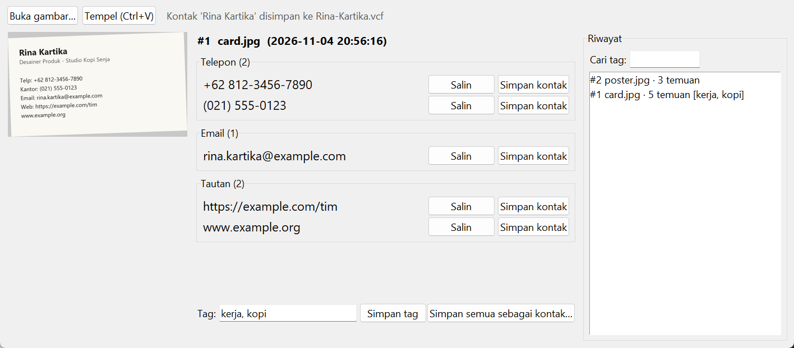

# Image Scanner

Membaca teks dari foto, lalu menemukan nomor telepon, email, dan tautan di dalamnya. Spesifikasi: [Image Scanner](https://github.com/florinpop17/app-ideas/blob/master/Projects/2-Intermediate/Image-Scaner.md).

OCR memakai mesin bawaan Windows 10/11 (`Windows.Media.Ocr`) lewat skrip PowerShell [`windows_ocr.ps1`](windows_ocr.ps1), jadi Tesseract tidak perlu dipasang. Jendela Tkinter. Butuh `pillow` untuk pratinjau gambar dan tempel dari clipboard (`pip install pillow`).



## Menjalankan

```bash
python scanner.py                                              # jendela
python scanner.py contoh/kartu-nama.jpg                        # terminal
python scanner.py contoh/kartu-nama.jpg --vcf rina.vcf --tag kerja
python scanner.py --history --tag kerja                        # riwayat bertag "kerja"
```

Keluaran `python scanner.py contoh/kartu-nama.jpg`:

```
Telepon:
  - +62 812-3456-7890
  - (021) 555-0123
Email:
  - rina.kartika@example.com
Tautan:
  - https://example.com/tim
  - www.example.org

Dicatat di riwayat sebagai #1.
```

Gambar `contoh/poster.jpg` sengaja dibuat kecil, sedikit buram, dan berkualitas JPEG rendah. Hasilnya tetap lengkap: `0857 1234 5678`, `panitia@example.org`, dan `example.org/daftar`.

## Di jendela

- **Membuka gambar:** **Buka gambar…** memilih foto dari folder. **Tempel (Ctrl+V)** memindai gambar dari clipboard, misalnya tangkapan layar atau foto dari ponsel yang disalin.
- **Kartu hasil:** dikelompokkan menjadi Telepon, Email, dan Tautan. Setiap temuan punya tombol **Salin** dan **Simpan kontak**, yang menyimpan temuan itu sebagai berkas `.vcf`. **Simpan semua sebagai kontak…** menyimpan semua temuan dalam satu kontak. Nama kontak ditebak dari baris teks pertama yang tampak seperti nama.
- **Riwayat:** setiap pemindaian masuk ke daftar di kanan dan disimpan di `~/.app-ideas-python/scanner-history.json`. Klik sebuah entri untuk melihat hasilnya lagi.
- **Tag:** isi kolom **Tag** (pisahkan dengan koma), lalu **Simpan tag**. Kolom **Cari tag** menyaring riwayat.

Berkas `.vcf` (vCard 3.0) bisa diimpor ke aplikasi Kontak di Android/iPhone, Google Contacts, atau Outlook.

## Aturan pengenalan

- **Telepon:** diawali `+`, `0`, atau `(0`, berisi 8–15 digit, dan boleh dipisah spasi, titik, tanda hubung, atau tanda kurung. Tanggal seperti `04-11-2026`, harga seperti `150.000`, dan kode pendek tidak dihitung. Nomor yang sama dengan format berbeda hanya muncul sekali. Di vCard, nomor ditulis tanpa pemisah (`+6281234567890`). Keterbatasan: nomor lokal tanpa awalan `0` atau `+`, seperti `555-123-4567`, tidak dikenali.
- **Email:** pola `nama@domain.akhiran`, tanpa membedakan huruf besar kecil saat membuang duplikat.
- **Tautan:** alamat yang diawali `http(s)://` atau `www.`. Domain tanpa awalan, seperti `bit.ly/abc` atau `tokoku.id`, juga dikenali kalau akhirannya umum atau diikuti path `/...`. Karena itu `foto.jpg`, `09.00`, `v1.2.3`, dan `Mr.Smith` tidak dianggap tautan. Tanda baca di ujung tautan, seperti titik atau tanda kurung penutup kalimat, dibuang.

## Yang tidak dibuat

- **Kamera:** mengambil foto langsung dari kamera tidak dibuat. Sebagai gantinya ada **Buka gambar…** dan **Tempel** dari clipboard.
- **Login dan sinkronisasi antarperangkat:** bonus ini tidak dibuat.
- **Gambar di riwayat:** riwayat menyimpan teks dan temuan, bukan berkas gambarnya.

## Tes

```bash
python -m unittest -v
```

Ekstraksi, vCard, riwayat, dan jendela diuji dengan teks tiruan. Satu tes integrasi membuat gambar dengan Pillow lalu menjalankan OCR Windows yang sungguhan. Tes itu dilewati di luar Windows.

## Pemetaan user stories

- [ ] Mengambil foto dengan kamera (belum), atau mengunggah foto dari galeri (bisa, lewat Buka gambar… dan Tempel)
- [x] Gambar diproses (OCR)
- [x] Nomor telepon, email, dan tautan ditampilkan dalam kartu yang terkelompok
- [x] Pilihan untuk menyimpan temuan sebagai kontak (`.vcf`)
- [x] Riwayat hasil pemindaian dalam bentuk daftar
- [x] Bonus: tag untuk setiap hasil pemindaian
- [x] Bonus: pencarian berdasarkan tag
- [ ] Bonus: login dan sinkronisasi antarperangkat
