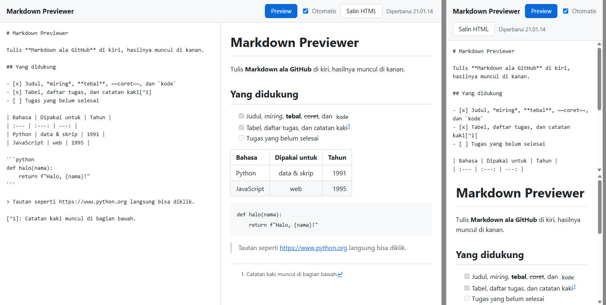
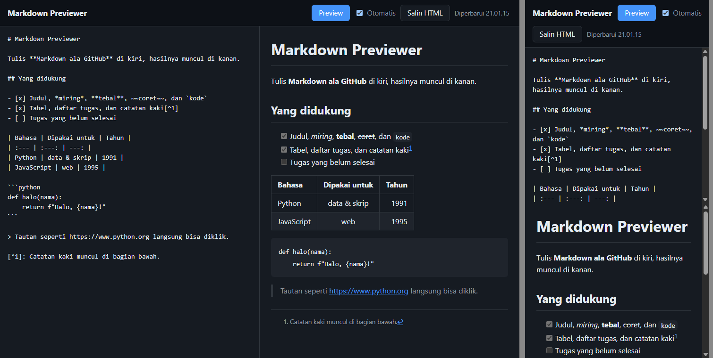

# Markdown Previewer

Tulis Markdown ala GitHub di kiri, lalu lihat hasil HTML-nya di kanan. Spesifikasi: [Markdown Previewer](https://github.com/florinpop17/app-ideas/blob/master/Projects/2-Intermediate/Markdown-Previewer.md).

Markdown dirender di Python dengan [mistune](https://github.com/lepture/mistune) (`pip install mistune`), lengkap dengan plugin tabel, coret, daftar tugas, auto-link, dan catatan kaki. Program menjalankan server lokal kecil dengan `http.server`, lalu membuka halaman editor di browser. Halaman itu hanya berisi sedikit JavaScript: mengirim teks ke server, menampilkan HTML yang dikembalikan, menyimpan teks di `localStorage`, dan menyalin ke clipboard. Pratinjau HTML memang butuh browser, karena Tkinter tidak bisa menampilkan HTML.



## Menjalankan

```bash
python md_preview.py                          # buka editor di browser
python md_preview.py --port 8765 --no-browser # port tetap, buka sendiri http://127.0.0.1:8765/
python md_preview.py catatan.md -o catatan.html   # render berkas tanpa server
```

Tekan `Ctrl+C` di terminal untuk menghentikan server. Server hanya mendengarkan di `127.0.0.1`, jadi tidak bisa diakses dari komputer lain.

## Di editor

- **Preview:** merender teks ke kotak sebelah kanan.
- **Otomatis** (nyala saat pertama dibuka): pratinjau ikut diperbarui saat mengetik, dengan jeda 250 ms setelah ketikan terakhir. Kalau dimatikan, pratinjau baru berubah setelah **Preview** ditekan.
- **Salin HTML:** menyalin kode HTML hasil render ke clipboard.
- **Teks tersimpan:** teks disimpan di `localStorage` setiap kali diketik dan saat halaman ditutup. Saat editor dibuka lagi, teks terakhir muncul kembali. Tambahkan `?contoh=1` di alamat untuk memuat ulang teks contoh.
- **Tata letak:** di layar sempit, editor dan pratinjau tersusun atas-bawah. Tampilannya mengikuti mode terang/gelap sistem.



## Keamanan

mistune dipakai dengan `escape=True`, jadi HTML mentah di dalam Markdown, misalnya `<script>` atau ``, ditampilkan sebagai teks dan tidak dijalankan. Tautan `javascript:` diganti menjadi `#harmful-link`. Teks lebih dari 1 MB ditolak (kode 413).

## Yang sudah diverifikasi di browser

Halaman editor dijalankan di Chrome (headless) dan dikendalikan lewat skrip:

- Teks contoh langsung dirender saat halaman dibuka.
- Dengan **Otomatis**, mengetik memperbarui pratinjau, dan `` tampil sebagai teks.
- Dengan **Otomatis** dimatikan, pratinjau tidak berubah sampai **Preview** diklik.
- Setelah halaman dimuat ulang, teks terakhir masih ada di editor dan pratinjau.

**Salin HTML** belum terbukti di headless Chrome. Browser menolak menulis ke clipboard karena halamannya tidak sedang fokus ("Document is not focused"), dan pesan itu tampil di baris status. Saat dipakai biasa (mengklik tombolnya sendiri), halaman sedang fokus, tetapi alur itu belum saya coba secara manual.

## Tes

```bash
python -m unittest -v
```

Tes memeriksa hasil render (fitur GFM, escape, tautan berbahaya), halaman editor, dan server sungguhan di port acak: halaman, `/render`, 404, dan 413.

## Pemetaan user stories

- [x] Menulis Markdown ala GitHub di `textarea`
- [x] Melihat hasil HTML di kotak lain dengan menekan tombol
- [x] Bonus: HTML otomatis diperbarui saat teks berubah
- [x] Bonus: teks disimpan di `localStorage` dan muncul lagi saat editor dibuka kembali
- [x] Bonus: tombol untuk menyalin isi kotak ke clipboard (lihat catatan verifikasi di atas)
