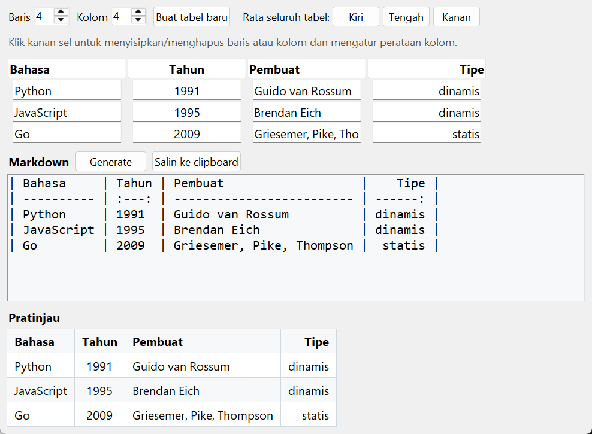

# Markdown Table Generator

Isi tabel di jendela, lalu dapatkan tabel Markdown yang rapi. Spesifikasi: [Markdown Table Generator](https://github.com/florinpop17/app-ideas/blob/master/Projects/2-Intermediate/Markdown-Table-Generator.md).

Jendela Tkinter, plus mode terminal untuk mengubah CSV menjadi tabel Markdown. Hanya pustaka bawaan Python (tesnya memakai `mistune` untuk memeriksa hasil).



## Menjalankan

```bash
python md_table.py                            # jendela
python md_table.py data.csv                   # CSV -> Markdown di terminal
python md_table.py data.csv --align l,c,r     # perataan per kolom (l, c, r, n)
python md_table.py - < data.csv               # baca dari stdin
```

Di jendela:

- **Membuat tabel:** atur jumlah **Baris** dan **Kolom**, lalu tekan **Buat tabel baru**. Baris pertama menjadi judul kolom.
- **Mengisi:** ketik di setiap sel. Hasil Markdown dan pratinjaunya langsung diperbarui.
- **Menu klik kanan** pada sebuah sel:
  - sisipkan baris di atas/bawah atau kolom di kiri/kanan sel itu,
  - hapus baris atau kolom itu,
  - atur perataan kolom itu.
- **Rata seluruh tabel:** tombol Kiri, Tengah, atau Kanan di bilah atas.
- **Salin ke clipboard:** menyalin tabel Markdown.

Contoh keluaran `python md_table.py kota.csv --align l,c,r`:

```
| Kota     |     Provinsi      | Penduduk (juta) |
| :------- | :---------------: | --------------: |
| Surabaya |    Jawa Timur     |             2.9 |
| Medan    | Sumatera \| Utara |             2.5 |
| 東京     |       Tokyo       |              14 |
```

## Detail

- **Kolom lurus:** setiap kolom diisi spasi sampai lurus. Huruf lebar seperti CJK (`東京`) dan emoji dihitung 2 kolom, supaya tetap lurus di font monospace. Baris pemisah (`:---`, `:---:`, `---:`) sama panjang dengan kolomnya.
- **Isi sel:** `|` di dalam sel di-escape menjadi `\|`, dan baris baru menjadi `<br>`. Tes memastikan hasilnya terbaca sebagai tabel yang benar oleh parser Markdown (mistune).
- **CSV:** CSV dari Excel (dengan BOM) bisa dibaca, sel yang berisi koma juga, dan baris kosong dilewati.

## Soal perataan sel dan baris

Spesifikasi juga menyebut perataan per **sel** dan per **baris**. Markdown tidak punya cara untuk itu, karena perataan hanya ditentukan oleh baris pemisah, satu nilai untuk setiap kolom. Karena itu yang tersedia hanya perataan per kolom dan untuk seluruh tabel.

## Tes

```bash
python -m unittest -v
```

## Pemetaan user stories

- [x] Membuat tabel dengan jumlah baris dan kolom tertentu
- [x] Mengisi teks di setiap sel
- [x] Menghasilkan tabel Markdown dari isi tabel
- [x] Pratinjau tabel Markdown
- [x] Bonus: tombol untuk menyalin tabel Markdown ke clipboard
- [x] Bonus: menyisipkan baris atau kolom di posisi tertentu
- [x] Bonus: menghapus baris atau kolom
- [ ] Bonus: perataan sel, kolom, baris, atau seluruh tabel. Kolom dan seluruh tabel bisa, sel dan baris tidak, karena Markdown tidak mendukungnya (lihat di atas).
