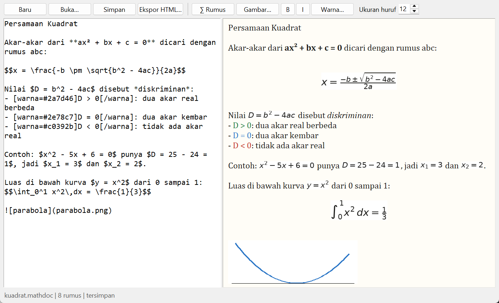
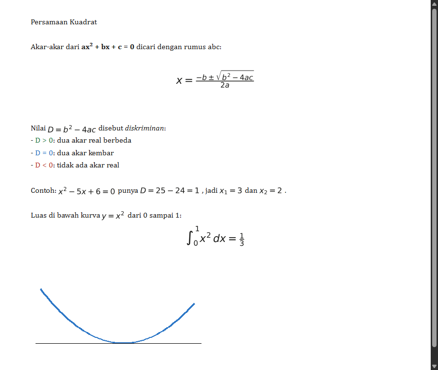

# Math Editor

Editor dokumen teks dengan rumus matematika. Dokumen bisa disimpan sebagai berkas, lalu dibuka lagi dengan semua rumusnya tetap utuh. Spesifikasi: [Math Editor](https://github.com/florinpop17/app-ideas/blob/master/Projects/2-Intermediate/math-editor.md).

Jendela Tkinter. Rumus digambar dengan `matplotlib.mathtext`. Butuh `matplotlib` dan `pillow` (`pip install matplotlib pillow`).



## Menjalankan

```bash
python math_editor.py                                        # dokumen contoh
python math_editor.py contoh/persamaan-kuadrat.mathdoc       # buka dokumen
python math_editor.py contoh/persamaan-kuadrat.mathdoc --html kuadrat.html   # ekspor HTML
```

Ketik di kiri, dan pratinjaunya diperbarui di kanan 0,3 detik setelah berhenti mengetik.

| Tulis | Hasil |
| --- | --- |
| `$x^2 + y^2 = r^2$` | rumus di dalam kalimat |
| `$$\frac{-b \pm \sqrt{b^2-4ac}}{2a}$$` | rumus di baris sendiri, di tengah |
| `**tebal**`, `*miring*` | **tebal**, *miring* |
| `[warna=#c0392b]teks[/warna]` | teks berwarna |
| `` | gambar |
| `\$5` | tanda dolar biasa |

Tombol di bilah atas:

- **∑ Rumus:** menyisipkan rumus LaTeX. Rumus dicek dulu, dan yang salah, misalnya `\frac{1}{`, tidak disisipkan dan memunculkan pesan.
- **Gambar…:** menyisipkan gambar.
- **B**, **I**, dan **Warna…:** memformat teks yang dipilih.
- **Ukuran huruf:** 8–40.
- **Baru**, **Buka…**, **Simpan** (`Ctrl+S`), dan **Ekspor HTML…**

## Berkas dokumen

Dokumen disimpan sebagai `.mathdoc`, yaitu berkas JSON yang berisi teks sumber (beserta LaTeX rumusnya), ukuran huruf, dan gambar yang disisipkan (base64). Karena gambarnya ikut tersimpan, dokumen tetap utuh walaupun dipindah ke komputer lain atau berkas gambar aslinya dihapus. Tes memeriksa kasus itu. Rumus disimpan sebagai teks LaTeX, bukan gambar, jadi tetap bisa diedit setelah dibuka lagi.

Contohnya ada di [`contoh/persamaan-kuadrat.mathdoc`](contoh/persamaan-kuadrat.mathdoc).

## Ekspor HTML

**Ekspor HTML…** (atau `--html`) menghasilkan satu berkas HTML mandiri. Rumus ditanam sebagai SVG dengan ukuran yang sama dengan huruf teks, dan gambar ditanam sebagai data-URI. Rumus yang salah ditandai merah, tanpa menggagalkan ekspor.



## Batasan

`matplotlib.mathtext` mendukung sebagian besar LaTeX matematika: pecahan, akar, pangkat, indeks, integral, sigma, huruf Yunani, dan simbol. Lingkungan seperti `\begin{matrix}` atau `\begin{align}` tidak didukung. Rumus yang tidak didukung akan tampil sebagai pesan kesalahan merah di pratinjau.

## Tes

```bash
python -m unittest -v
```

## Pemetaan user stories

- [x] Menulis dokumen teks
- [x] Menambahkan rumus matematika ke dokumen
- [x] Menyimpan dokumen sebagai berkas lokal (`.mathdoc`)
- [x] Membuka berkas dengan semua rumus tetap utuh
- [x] Bonus: mengubah ukuran huruf
- [x] Bonus: mengubah atribut teks lain (tebal, miring, warna)
- [x] Bonus: menambahkan gambar ke dokumen
