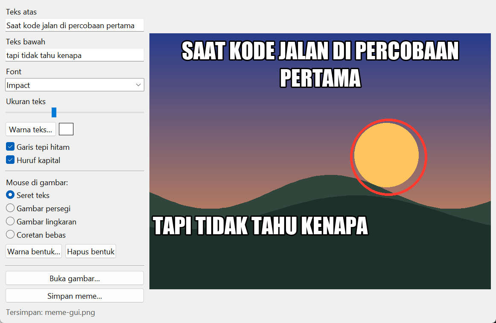
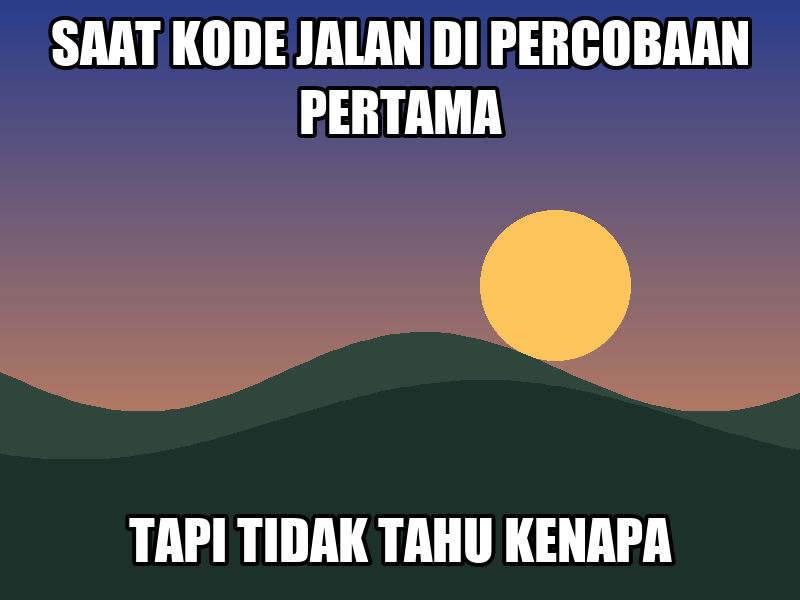

# Meme Generator

Buka gambar, tambahkan teks di atas dan bawah, atur warna, ukuran, dan font, lalu simpan sebagai meme. Spesifikasi: [Meme Generator App](https://github.com/florinpop17/app-ideas/blob/master/Projects/2-Intermediate/Meme-Generator-App.md).

Jendela Tkinter. Butuh `pillow` (`pip install pillow`).



## Menjalankan

```bash
python meme.py                     # jendela, mulai dengan gambar contoh
python meme.py foto.jpg            # jendela dengan gambar sendiri
python meme.py foto.jpg --top "SAAT KODE JALAN" --bottom "TAPI TIDAK TAHU KENAPA" -o meme.png
python meme.py --top "..." --font "Comic Sans" --color "#ffd60a" --size 70 -o meme.jpg
```

Hasil perintah terakhir di atas tanpa `foto.jpg`, yaitu dengan gambar contoh:



Di jendela:

- **Teks:** ketik **Teks atas** dan **Teks bawah**. Gambar langsung diperbarui.
- **Gaya teks:** pilih **Font** (Impact, Arial Black, Comic Sans, dan lain-lain, sesuai yang terpasang), atur **Ukuran teks**, **Warna teks…**, **Garis tepi hitam**, dan **Huruf kapital**.
- **Mouse di gambar:**
  - **Seret teks** untuk memindahkan teks ke mana saja.
  - Pilih **Gambar persegi**, **Gambar lingkaran**, atau **Coretan bebas** untuk menggambar di atas gambar. **Warna bentuk…** dan **Hapus bentuk** ada di bawahnya.
- **Simpan meme…** (`Ctrl+S`): menyimpan sebagai PNG atau JPG.

## Cara kerja

Meme selalu digambar oleh Pillow, lalu hasilnya ditampilkan di Canvas. Karena itu yang terlihat di jendela sama persis dengan berkas yang disimpan.

- **Teks panjang:** dibungkus menjadi beberapa baris sesuai lebar gambar. Posisinya dijaga supaya tidak keluar dari tepi gambar.
- **Garis tepi:** hitam, setebal 1/14 ukuran huruf, seperti gaya meme klasik.
- **Posisi teks:** disimpan relatif terhadap ukuran gambar (0–1), jadi tetap di tempat yang sama saat gambarnya diganti.
- **Gambar besar:** diperkecil sampai sisi terpanjangnya 900 piksel.
- **Gambar contoh:** langit senja yang dibuat dengan kode, jadi bebas hak cipta.

## Tes

```bash
python -m unittest -v
```

## Pemetaan user stories

- [x] Mengunggah gambar yang tampil di canvas
- [x] Menambahkan teks di bagian atas gambar
- [x] Menambahkan teks di bagian bawah gambar
- [x] Memilih warna teks
- [x] Memilih ukuran teks
- [x] Menyimpan meme
- [x] Bonus: memilih font
- [ ] Bonus: membagikan ke media sosial (tidak dibuat; simpan lalu unggah sendiri)
- [x] Bonus: menyeret teks ke posisi mana saja
- [x] Bonus: menggambar bentuk di atas gambar (persegi, lingkaran, coretan bebas)
