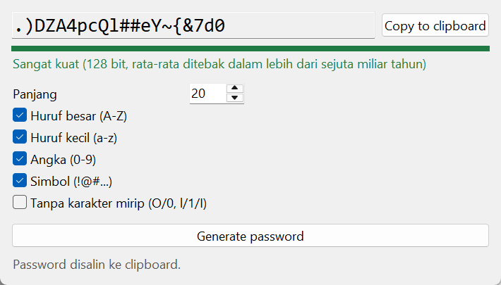

# Password Generator

Membuat password acak yang aman, lengkap dengan ukuran kekuatannya. Spesifikasi: [Password Generator](https://github.com/florinpop17/app-ideas/blob/master/Projects/2-Intermediate/Password-Generator.md).

Jendela Tkinter, plus mode terminal. Hanya pustaka bawaan Python.



## Menjalankan

```bash
python password.py                          # jendela
python password.py -l 20                    # terminal: 20 karakter, semua jenis
python password.py -l 12 --no-symbols -n 5  # 5 password tanpa simbol
python password.py -l 16 --no-ambiguous     # tanpa karakter mirip: O/0, l/1/I, S/5, B/8
```

Di jendela, atur panjang dan jenis karakter, lalu tekan **Generate password** (atau `Enter`). Password baru juga langsung dibuat setiap kali pengaturan diubah. **Copy to clipboard** menyalin password-nya.

## Keamanan

- **Sumber acak:** modul `secrets` (sumber acak kriptografis sistem operasi), bukan `random`, yang bisa ditebak.
- **Semua jenis muncul:** setiap jenis karakter yang dipilih dijamin muncul minimal sekali. Posisinya diacak, jadi huruf besar tidak selalu di depan.

## Kekuatan

Kekuatan diukur sebagai **entropi** dalam bit, yaitu log₂ dari banyaknya password yang mungkin dihasilkan dengan pengaturan itu. Karena ada syarat "minimal satu dari tiap jenis", jumlahnya sedikit kurang dari `N^panjang`. Jumlah yang tepat dihitung dengan prinsip **inklusi-eksklusi**, dan tes mencocokkannya dengan menghitung semua kemungkinan satu per satu untuk kasus kecil.

| Entropi | Label |
| --- | --- |
| < 60 bit | Lemah |
| 60–79 bit | Sedang |
| 80–127 bit | Kuat |
| ≥ 128 bit | Sangat kuat |

Perkiraan waktu tebak mengasumsikan penyerang mencoba 10¹² password per detik dan rata-rata menemukan jawabannya setelah mencoba separuh kemungkinan. Dengan semua jenis karakter:

```
8   Lemah (50 bit, rata-rata ditebak dalam sekitar 12 menit)
12  Sedang (77 bit, rata-rata ditebak dalam sekitar 1.899 tahun)
16  Kuat (103 bit, rata-rata ditebak dalam sekitar 121 miliar tahun)
20  Sangat kuat (128 bit, rata-rata ditebak dalam lebih dari sejuta miliar tahun)
```

## Tes

```bash
python -m unittest -v
```

Tes jendela untuk tombol **Copy to clipboard** benar-benar menulis ke clipboard sistem, jadi isi clipboard tertimpa saat tes dijalankan.

## Pemetaan user stories

- [x] Memilih panjang password
- [x] Memilih satu atau beberapa jenis karakter: huruf besar, huruf kecil, angka, dan simbol
- [x] Tombol Generate password untuk melihat password baru
- [x] Tombol Copy to clipboard
- [x] Bonus: menampilkan kekuatan password
