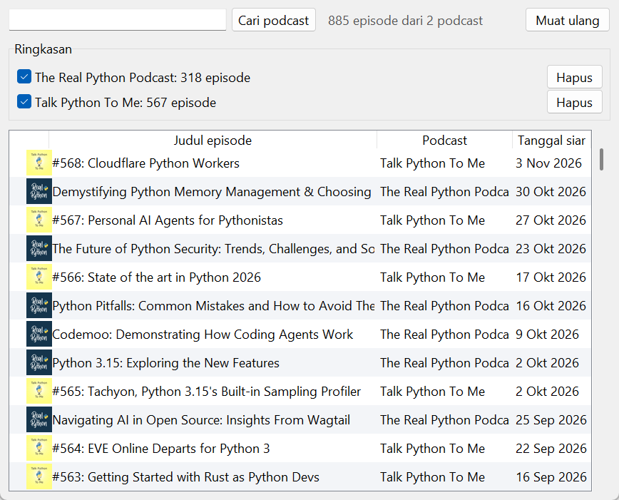

# Podcast Directory

Tabel episode dari podcast favorit. Ikonnya bisa diklik untuk membuka halaman episode. Spesifikasi: [Podcast Directory](https://github.com/florinpop17/app-ideas/blob/master/Projects/2-Intermediate/Podcast-Directory-App.md).

Podcast dicari lewat [iTunes Search API](https://performance-partners.apple.com/search-api) (gratis, tanpa kunci). Episode diambil dari **feed RSS** masing-masing podcast. Spesifikasi menyebut Podbean, tetapi API Podbean butuh kredensial OAuth. Feed RSS adalah sumber yang sama yang dibaca semua aplikasi podcast, termasuk untuk podcast yang di-hosting di Podbean.

Jendela Tkinter, plus mode terminal. Butuh `pillow` untuk ikon (`pip install pillow`).



## Menjalankan

```bash
python podcasts.py                          # jendela
python podcasts.py search "python"          # cari podcast, tampilkan id iTunes
python podcasts.py add 1501905538           # tambah ke favorit
python podcasts.py list
python podcasts.py episodes -n 8            # episode terbaru dari semua favorit
python podcasts.py remove 1501905538
```

Favorit disimpan di `~/.app-ideas-python/podcasts.json`. Di jendela, ketik nama podcast lalu **Cari podcast** untuk memilih podcast yang mau ditambahkan.

Keluaran `python podcasts.py episodes -n 8` dengan dua favorit (4 November 2026):

```
The Real Python Podcast: 318 episode
Talk Python To Me: 567 episode

  3 Nov 2026  Talk Python To Me         #568: Cloudflare Python Workers
 30 Okt 2026  The Real Python Podcast   Demystifying Python Memory Management & Choosing a Project Layout
 27 Okt 2026  Talk Python To Me         #567: Personal AI Agents for Pythonistas
 23 Okt 2026  The Real Python Podcast   The Future of Python Security: Trends, Challenges, and Solutions
 17 Okt 2026  Talk Python To Me         #566: State of the art in Python 2026
 16 Okt 2026  The Real Python Podcast   Python Pitfalls: Common Mistakes and How to Avoid Them
  9 Okt 2026  The Real Python Podcast   Codemoo: Demonstrating How Coding Agents Work
  2 Okt 2026  The Real Python Podcast   Python 3.15: Exploring the New Features
```

## Detail

- **Urutan:** episode dari semua podcast digabung dan diurutkan dari yang terbaru. Tanggal di feed (RFC 2822, berbeda-beda zona waktunya) dibandingkan dengan benar.
- **Pengambilan data:** feed dan ikon diambil di thread terpisah, jadi jendela tetap bisa dipakai selama memuat. Hasilnya diteruskan ke Tkinter lewat antrean, karena Tkinter tidak aman dipanggil dari thread lain.
- **Tautan:** tautan episode diambil dari `<link>`, atau dari `<guid>` kalau berupa alamat web. Tautan selain `http(s)://` dibuang.
- **Keamanan:** feed dari internet diurai dengan `xml.etree.ElementTree`, yang tidak memuat entitas eksternal. Expat bawaan Python 3.12 juga membatasi ledakan entitas ("billion laughs"). Tes memeriksa bahwa entitas `SYSTEM` tidak membaca berkas lokal.

## Tes

```bash
python -m unittest -v
```

Tes memakai feed RSS dan jawaban iTunes tiruan, termasuk tes jendela.

## Pemetaan user stories

- [x] Tabel episode podcast
- [x] Setiap baris berisi ikon episode yang bisa diklik, judul episode, dan tanggal siar
- [x] Daftar bisa digulir
- [x] Klik ikon membuka halaman episode (dari feed RSS, sebagai pengganti situs Podbean)
- [x] Bonus: warna latar baris selang-seling
- [x] Bonus: ringkasan jumlah episode untuk setiap podcast di atas tabel
- [x] Bonus: checkbox di samping setiap nama podcast di ringkasan
- [x] Bonus: checkbox itu menentukan podcast mana yang episodenya tampil di tabel
