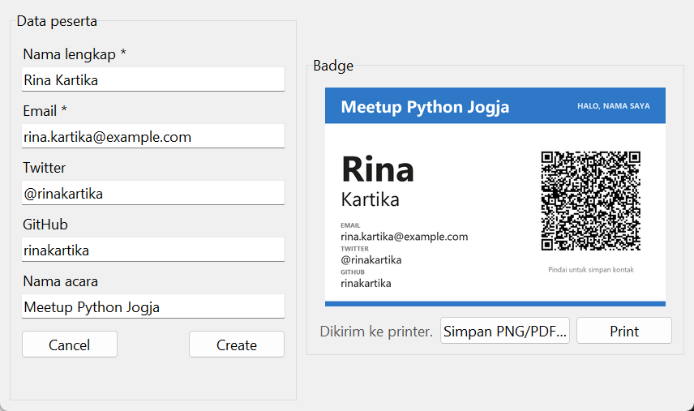
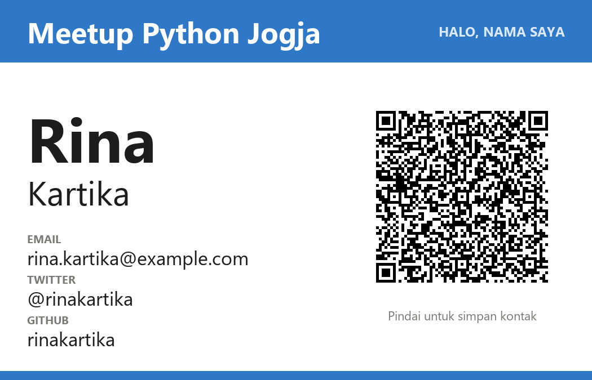

# QR Code Badge Generator

Isi data peserta acara, lalu buat badge nama dengan QR code yang bisa dipindai ponsel. Spesifikasi: [QRCode Badge Generator](https://github.com/florinpop17/app-ideas/blob/master/Projects/2-Intermediate/QRCode-Badge-App.md).

QR code berisi **kartu kontak (vCard)**, jadi saat dipindai, ponsel langsung menawarkan "Simpan kontak" berisi nama, email, Twitter, dan GitHub. QR dibuat dengan [segno](https://github.com/heuer/segno), padanan Python untuk paket NPM `qrcode-generator` di spesifikasi, dan badge digambar dengan Pillow.

```bash
pip install segno pillow
pip install zxing-cpp      # opsional, hanya untuk tes: membaca QR code
```



## Menjalankan

```bash
python badge.py      # jendela
python badge.py --name "Rina Kartika" --email rina.kartika@example.com --twitter rinakartika \
    --github rinakartika --event "Meetup Python Jogja" -o badge.png    # atau .pdf
```

Hasil perintah di atas (1050 × 675 piksel, yaitu 3,5 × 2,25 inci pada 300 dpi):



Di jendela:

- **Create:** memeriksa data lalu menampilkan badge. Kalau data diperbaiki, tekan **Create** lagi untuk memperbarui badge.
- **Cancel:** mengosongkan semua isian dan badge.
- **Print:** baru aktif setelah badge valid. Badge disimpan sebagai PDF lalu dikirim ke printer bawaan Windows.
- **Simpan PNG/PDF…:** menyimpan badge ke berkas.

## Pemeriksaan data

- **Nama dan email wajib.** Nama harus berisi nama depan dan nama belakang. Email harus berformat `nama@domain.akhiran`.
- **Twitter:** harus diawali `@`, tetapi `@` ditambahkan otomatis kalau lupa diketik. Isinya hanya huruf, angka, dan `_`, maksimal 15 karakter.
- **GitHub:** mengikuti aturan nama akun GitHub (huruf, angka, dan tanda hubung tunggal).

## QR code yang benar-benar bisa dipindai

Tes membaca QR di badge dengan **zxing-cpp** (pembaca barcode yang juga dipakai banyak aplikasi Android). Hasil bacaannya harus sama persis dengan vCard yang dimasukkan, termasuk saat badge diperkecil sampai sepertiganya. QR memakai tingkat koreksi kesalahan M (sekitar 15% QR boleh rusak atau tertutup), dan setiap modul QR digambar dengan ukuran piksel bulat yang sama supaya tajam saat dicetak.

## Tes

```bash
python -m unittest -v
```

Tes jendela memakai printer tiruan, jadi tidak ada yang benar-benar dicetak. Tes pemindaian QR dilewati kalau `zxing-cpp` tidak terpasang.

## Pemetaan user stories

- [x] Panel isian: nama, email, Twitter, GitHub, serta tombol Cancel dan Create
- [x] Nama dan email wajib, Twitter dan GitHub opsional
- [x] Cancel mengosongkan isian dan panel badge
- [x] Create membuat gambar badge nama
- [x] Pesan kesalahan: isian wajib kosong, tanpa nama depan dan belakang, email tidak valid, Twitter tanpa '@'
- [x] Panel badge berisi data peserta dan QR code berisi data itu
- [x] Bonus: tombol Print di bawah panel badge
- [x] Bonus: Print hanya aktif setelah data valid dan badge tampil
- [x] Bonus: memperbaiki isian lalu Create lagi untuk memperbarui badge
- [x] Bonus: Print mencetak badge (lewat printer bawaan Windows)
- [x] Bonus: '@' otomatis ditambahkan di depan akun Twitter
