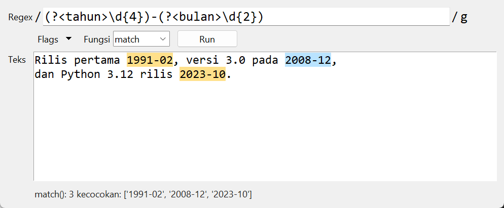

# Regular Expression Helper

Uji regular expression terhadap teks, lalu lihat bagian yang cocok disorot. Spesifikasi: [Regular Expression Helper](https://github.com/florinpop17/app-ideas/blob/master/Projects/2-Intermediate/RegExp-Helper-App.md).

Jendela Tkinter, plus mode terminal. Hanya pustaka bawaan Python.



## Menjalankan

```bash
python regex_helper.py                                                   # jendela
python regex_helper.py "\d+" "ada 12 apel dan 3 jeruk" --flags g --fn match
```

```
match(): 2 kecocokan: ['12', '3']
ada 12 apel dan 3 jeruk
    ^^          ^
```

Di jendela:

- **Regex dan teks:** tulis regex di kotak atas (di antara `/ /`, seperti di JavaScript) dan teks di kotak bawah.
- **Flags:** pilih dari menu, lalu pilih **Fungsi**.
- **Run** (`Ctrl+Enter`): bagian yang cocok disorot dengan dua warna bergantian, supaya kecocokan yang bersebelahan tetap terbedakan. Hasil fungsi muncul di bawah teks.
- **Peringatan:** muncul kalau regex atau teks kosong, kalau regex tidak valid (beserta posisinya), atau kalau tidak ada teks yang cocok.

## Meniru RegExp JavaScript

Spesifikasi ditulis untuk RegExp JavaScript, jadi fungsi dan flag-nya ditiru di atas modul `re` Python:

| Fungsi | Hasil |
| --- | --- |
| `test` | `true`/`false` |
| `search` | indeks kecocokan pertama, atau `-1` |
| `match` | tanpa `g`: kecocokan pertama dan grupnya. Dengan `g`: semua kecocokan. `null` kalau tidak ada. |

| Flag | Arti |
| --- | --- |
| `g` | global (semua kecocokan) |
| `i` | abaikan huruf besar/kecil |
| `m` | multiline: `^` dan `$` berlaku per baris |
| `s` | dotAll: `.` juga cocok dengan baris baru |
| `y` | sticky: harus cocok mulai dari posisi 0, dan dengan `g` kecocokannya harus bersambung |

Grup bernama gaya JavaScript `(?<nama>...)` otomatis diubah ke gaya Python `(?P<nama>...)`. Lookbehind `(?<=...)` dan `(?<!...)` tidak ikut diubah.

**Diperiksa dengan JavaScript sungguhan:** [`crosscheck_js.py`](crosscheck_js.py) menjalankan 3.159 kombinasi (13 pola × 9 teks × 9 set flag × 3 fungsi) di Python dan di mesin V8 Chrome, lalu membandingkan hasilnya. Hasilnya 0 berbeda. Perbedaan yang sempat ketahuan adalah `match` dengan `g` yang tidak menemukan apa pun: JavaScript mengembalikan `null`, sedangkan versi awal program ini mengembalikan `[]`.

```bash
python crosscheck_js.py     # butuh Google Chrome
```

Keterbatasan: yang ditiru adalah fungsi dan flag-nya, bukan seluruh sintaks regex JavaScript. Contohnya, `\d` di Python juga cocok dengan angka non-Latin (misalnya angka Arab), sedangkan di JavaScript tidak.

## Tes

```bash
python -m unittest -v
```

Spesifikasi menyarankan Jest untuk tes otomatis. Padanannya di Python adalah `unittest`.

## Pemetaan user stories

- [x] Menulis regular expression
- [x] Menulis teks yang diuji
- [x] Tombol Run
- [x] Peringatan kalau regex kosong
- [x] Peringatan kalau teks kosong
- [x] Teks yang cocok disorot
- [x] Pesan kalau tidak ada teks yang cocok
- [x] Bonus: memilih flag dari menu dropdown (global, abaikan besar/kecil, multiline, sticky, dan dotAll)
- [x] Bonus: memilih fungsi dari dropdown (test, search, match)
- [x] Bonus: pesan berisi hasil fungsi yang dipilih
- [x] Bonus: tes otomatis dengan framework pengujian (`unittest`)
