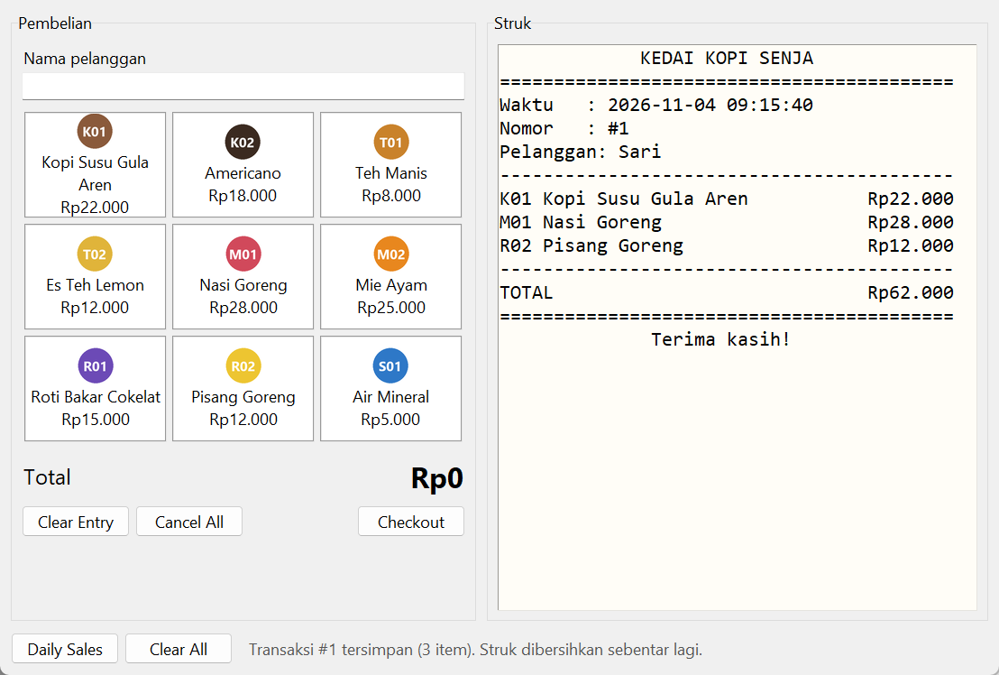
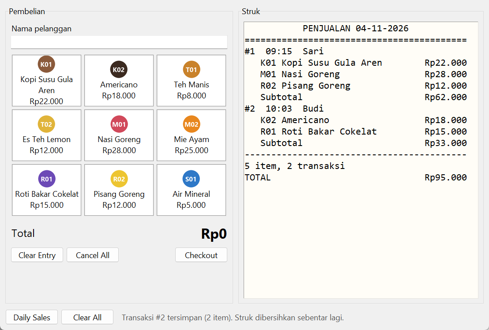

# Sales Receipts

Kasir sederhana: klik item, lihat struk, lalu checkout ke database SQLite. Spesifikasi: [Sales Receipts App](https://github.com/florinpop17/app-ideas/blob/master/Projects/2-Intermediate/Sales-DB-App.md).

Jendela Tkinter. Butuh `pillow` untuk gambar kecil di tombol item (`pip install pillow`).

| Setelah checkout | Daily Sales |
| --- | --- |
|  |  |

## Menjalankan

```bash
python sales.py              # jendela
python sales.py --daily      # rekap penjualan hari ini di terminal
python sales.py --db toko.db # pakai berkas database lain
```

Database bawaan ada di `~/.app-ideas-python/sales.db`.

- **Membeli:** isi **Nama pelanggan** (boleh kosong), lalu klik item. Struk di kanan menampilkan waktu transaksi dimulai, nama pelanggan, dan setiap item (nomor, nama, harga). Total di kiri ikut bertambah.
- **Clear Entry:** membatalkan item terakhir. **Cancel All** membatalkan semua item sebelum checkout.
- **Checkout:** semua item disimpan ke database dalam satu transaksi SQLite, jadi tersimpan semua atau tidak sama sekali. Struk final berisi nomor transaksi dan **TOTAL**, lalu dibersihkan otomatis 4 detik kemudian (atau langsung saat item berikutnya diklik).
- **Daily Sales:** menampilkan semua penjualan hari ini, dikelompokkan per transaksi lengkap dengan subtotal dan total.
- **Clear All:** menghapus semua catatan penjualan dari database, setelah konfirmasi.

Contoh **Daily Sales** dengan dua transaksi:

```
           PENJUALAN 04-11-2026
==========================================
#1  09:15  Sari
   K01 Kopi Susu Gula Aren        Rp22.000
   M01 Nasi Goreng                Rp28.000
   R02 Pisang Goreng              Rp12.000
   Subtotal                       Rp62.000
#2  10:03  Budi
   K02 Americano                  Rp18.000
   R01 Roti Bakar Cokelat         Rp15.000
   Subtotal                       Rp33.000
------------------------------------------
5 item, 2 transaksi
TOTAL                             Rp95.000
```

## Database

Setiap item yang dibeli menjadi satu baris di tabel `sales`:

| Kolom | Isi |
| --- | --- |
| `sale_id` | nomor transaksi (sama untuk semua item dalam satu checkout) |
| `sold_at` | waktu checkout (ISO 8601) |
| `customer` | nama pelanggan |
| `item_number`, `description`, `unit_price` | data item (harga dalam rupiah, bilangan bulat) |

Harga disimpan sebagai bilangan bulat rupiah, bukan `float`, supaya totalnya selalu tepat.

## Tes

```bash
python -m unittest -v
```

## Pemetaan user stories

- [x] Panel pembelian dengan tombol untuk setiap item (nomor, nama, harga), serta tombol Checkout
- [x] Klik tombol item untuk membeli
- [x] Total penjualan bertambah setiap kali item dibeli
- [x] Panel struk berisi tanggal dan waktu, serta setiap item (nomor, nama, harga)
- [x] Membatalkan pembelian sebelum checkout (lewat Cancel All, sesuai bonus)
- [x] Checkout menambahkan total ke akhir struk dan menyimpan semua item ke database
- [x] Struk dibersihkan setelah item tersimpan di database
- [x] Tombol Daily Sales dan Clear All di bagian bawah jendela
- [x] Daily Sales menampilkan semua item yang dibeli semua pelanggan beserta totalnya
- [x] Clear All membersihkan struk dan menghapus semua catatan penjualan dari database
- [x] Bonus: gambar kecil di setiap tombol item
- [x] Bonus: tombol Clear diganti dengan Clear Entry dan Cancel All
- [x] Bonus: Clear Entry membatalkan item terakhir
- [x] Bonus: Cancel All membatalkan semua pembelian sebelum checkout
- [x] Bonus: nama pelanggan ikut tercatat di struk dan di setiap baris database
