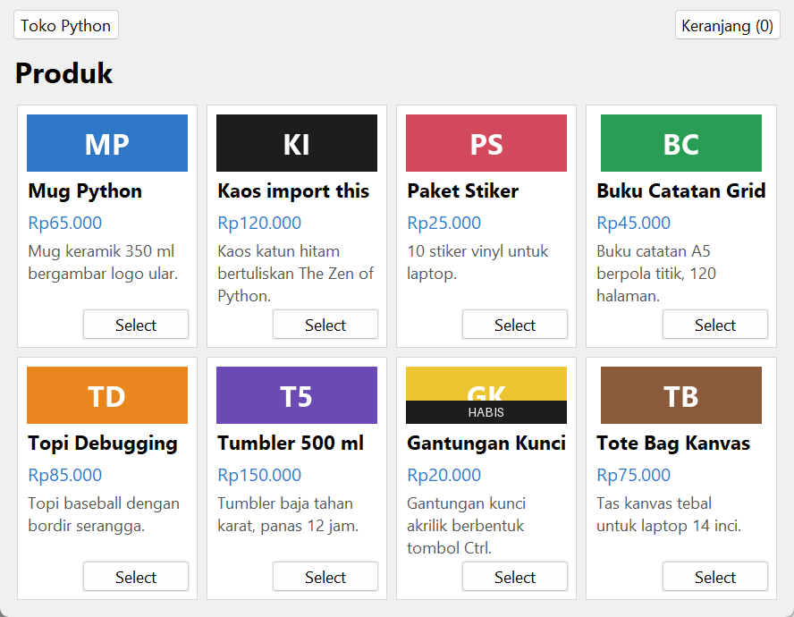
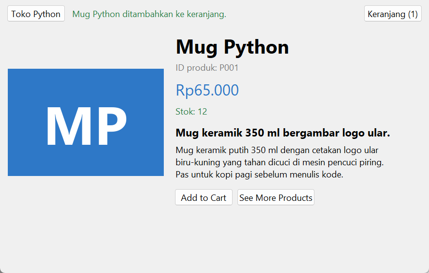
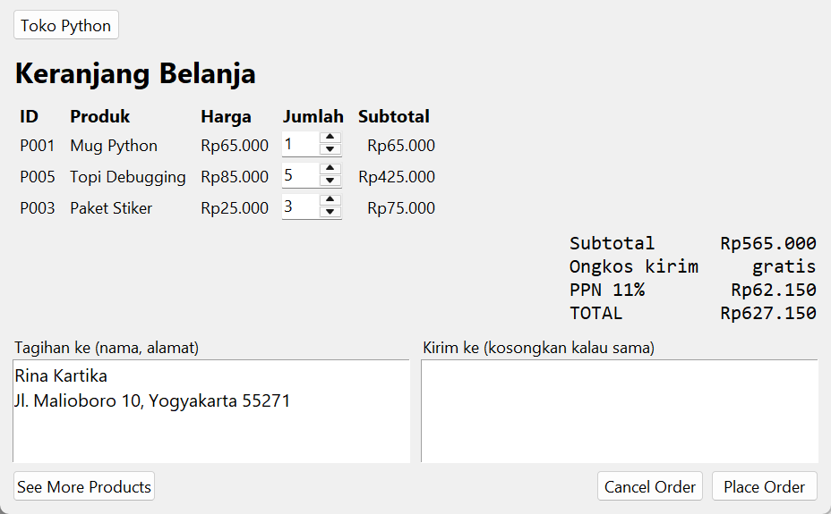
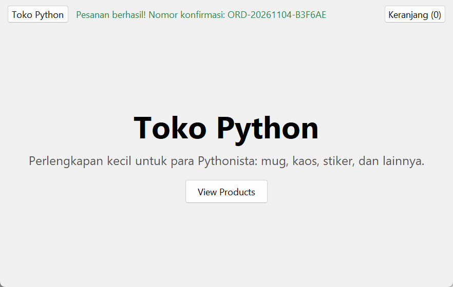

# Simple Online Store

Toko daring sederhana: beranda, katalog produk, halaman detail, dan keranjang belanja. Spesifikasi: [Simple Online Store](https://github.com/florinpop17/app-ideas/blob/master/Projects/2-Intermediate/Simple-Online-Store.md).

Jendela Tkinter dengan beberapa "halaman". Butuh `pillow` untuk gambar produk (`pip install pillow`).

| Produk | Detail | Keranjang |
| --- | --- | --- |
|  |  |  |

## Menjalankan

```bash
python store.py
```

1. **Beranda:** tekan **View Products**.
2. **Produk:** setiap kartu berisi gambar, nama, harga, deskripsi singkat, dan tombol **Select**.
3. **Detail:** berisi id produk, deskripsi panjang, stok, **Add to Cart** (dengan pesan konfirmasi), dan **See More Products**.
4. **Keranjang:** tombolnya ada di kanan atas beranda dan halaman produk, lengkap dengan jumlah barang. Halaman keranjang berisi:
   - tabel id, nama, harga, kotak jumlah, dan subtotal per baris,
   - total yang langsung dihitung ulang saat jumlah diubah,
   - **Place Order:** menampilkan nomor konfirmasi, misalnya `ORD-20261104-B3F6AE`,
   - **Cancel Order:** mengembalikan jumlah dan total ke nol,
   - **See More Products:** kembali ke katalog tanpa mengosongkan keranjang.



## Perhitungan

```
Subtotal                       jumlah harga × kuantitas
Ongkos kirim                   Rp15.000, gratis mulai belanja Rp200.000
PPN 11%                        11% dari subtotal
TOTAL                          subtotal + ongkos kirim + PPN
```

Contoh di screenshot keranjang: 1 mug (Rp65.000) + 5 topi (Rp425.000) + 3 stiker (Rp75.000) = Rp565.000. Ongkos kirimnya gratis, PPN-nya Rp62.150, jadi totalnya **Rp627.150**.

## Inventaris dan pesanan

- **Katalog:** produk disimpan di berkas terpisah, [`products.json`](products.json) (bonus "inventaris di berkas eksternal"). Isinya id, nama, harga, stok, warna gambar, serta deskripsi singkat dan panjang.
- **Stok:** jumlah yang melebihi stok ditolak dengan pesan, begitu juga produk yang habis (Gantungan Kunci). Stok diperiksa sekali lagi tepat sebelum pesanan dibuat. Sisa stok setelah pesanan disimpan di `~/.app-ideas-python/store-inventory.json`, jadi `products.json` tidak berubah.
- **Alamat:** saat **Place Order**, alamat tagihan wajib diisi (nama penerima dan alamat, minimal 2 baris). Alamat kirim boleh dikosongkan kalau sama dengan alamat tagihan.
- **Riwayat pesanan:** setiap pesanan (nomor, waktu, alamat, item, dan total) dicatat di `~/.app-ideas-python/store-orders.json`.

## Tes

```bash
python -m unittest -v
```

## Pemetaan user stories

- [x] Tombol View Products di beranda membuka halaman produk
- [x] Kartu produk berisi gambar, nama, harga, deskripsi singkat, dan tombol Select
- [x] Select membuka detail produk: id, deskripsi panjang, Add to Cart, dan See More Products
- [x] Pesan konfirmasi saat produk masuk keranjang
- [x] See More Products kembali ke halaman produk
- [x] Tombol keranjang di beranda dan halaman produk (di bilah atas)
- [x] Halaman keranjang berisi id, nama, harga, dan kotak jumlah untuk setiap produk
- [x] Total pembelian = jumlah (kuantitas × harga)
- [x] Mengubah jumlah memperbarui total
- [x] Place Order menyelesaikan pesanan dan menampilkan nomor konfirmasi
- [x] Cancel Order mengembalikan jumlah dan total ke nol
- [x] See More Products dari keranjang tanpa mengosongkan keranjang
- [x] Bonus: pesan kesalahan kalau jumlah melebihi stok
- [x] Bonus: alamat tagihan dan alamat kirim
- [x] Bonus: ongkos kirim ditambahkan ke total
- [x] Bonus: pajak penjualan (PPN 11%) ditambahkan ke total
- [x] Bonus: inventaris di berkas eksternal (`products.json`)
