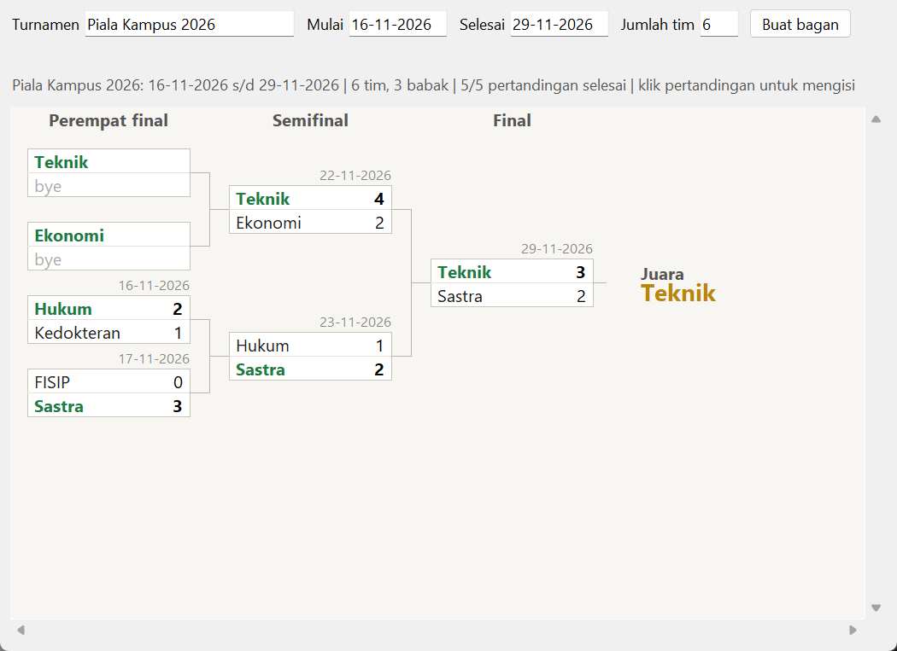

# Sports Bracket Generator

Membuat bagan turnamen sistem gugur, lalu mengisi nama tim, jadwal, dan skor setiap pertandingan. Spesifikasi: [Sports Bracket Generator](https://github.com/florinpop17/app-ideas/blob/master/Projects/2-Intermediate/Sports-Bracket-Generator.md).

Jendela Tkinter, hanya pustaka bawaan Python.



## Menjalankan

```bash
python bracket.py
```

1. **Membuat bagan:** isi nama turnamen, tanggal mulai dan selesai (`HH-BB-TTTT`), dan jumlah tim, lalu tekan **Buat bagan**.
2. **Mengisi pertandingan:** klik sebuah pertandingan untuk mengisi nama tim (di babak pertama), tanggal, dan skor.
3. **Pemenang maju:** pemenang (hijau tebal) otomatis maju ke babak berikutnya. Pemenang final ditampilkan sebagai **Juara**.

Semua data disimpan otomatis di `~/.app-ideas-python/bracket.json`, dan bagan terakhir muncul lagi saat aplikasi dibuka.

## Aturan

- **Peringatan:**
  - nama turnamen kosong,
  - tanggal tidak valid (misalnya `31-02-2026`) atau bukan format `HH-BB-TTTT`,
  - tanggal selesai sebelum tanggal mulai,
  - jumlah tim **ganjil**, kurang dari 2, atau lebih dari 64.
- **Bye:** jumlah tim genap yang bukan pangkat dua (6, 10, 12, …) diisi dengan *bye*. Misalnya dengan 6 tim, bagannya berukuran 8, dan dua tim pertama langsung lolos ke babak kedua. Bye tidak pernah bertemu bye.
- **Tanggal pertandingan:** harus berada di antara tanggal mulai dan selesai turnamen.
- **Skor:** tidak boleh seri, karena sistem gugur butuh pemenang (pakai skor setelah adu penalti). Skor baru bisa diisi setelah kedua tim diketahui.
- **Skor diubah:** kalau perubahan skor membuat pemenang suatu pertandingan berganti, hasil pertandingan berikutnya di jalur itu dibatalkan, karena timnya sudah lain. Kalau pemenangnya tetap sama, babak berikutnya tidak disentuh.

## Tes

```bash
python -m unittest -v
```

## Pemetaan user stories

- [x] Mengisi nama turnamen
- [x] Mengisi tanggal mulai dan tanggal selesai
- [x] Mengisi jumlah tim
- [x] Peringatan kalau tanggal mulai atau selesai tidak valid
- [x] Peringatan kalau jumlah tim ganjil
- [x] Bonus: mengisi nama tim untuk setiap pertandingan
- [x] Bonus: mengisi tanggal setiap pertandingan
- [x] Bonus: mengisi skor akhir setiap pertandingan
- [x] Bonus: data tetap tersimpan di sesi berikutnya
