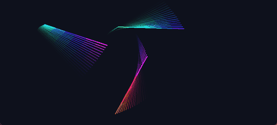
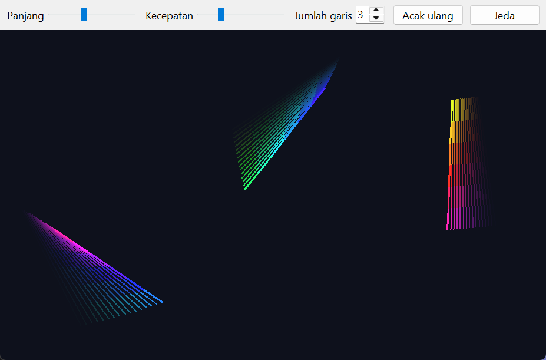

# String Art

Garis warna-warni yang bergerak, memantul di tepi jendela, dan meninggalkan jejak yang memudar seperti riak. Spesifikasi: [String Art](https://github.com/florinpop17/app-ideas/blob/master/Projects/2-Intermediate/String-Art.md).

Jendela Tkinter, hanya pustaka bawaan Python.



## Menjalankan

```bash
python string_art.py
```

Pengaturan di bilah atas:

- **Panjang** dan **Kecepatan** garis, yang langsung berlaku saat digeser.
- **Jumlah garis:** 1–8, dan setiap garis punya kecepatan sedikit berbeda.
- **Acak ulang:** memulai dari posisi acak baru.
- **Jeda** / **Lanjut**.



## Cara kerja

1. **Posisi awal:** setiap garis dimulai di posisi acak di dalam jendela. Garis punya titik tengah, arah gerak, sudut, panjang, dan kecepatan.
2. **Setiap 20 ms:**
   - titik tengah bergeser sejauh kecepatan ke arah geraknya,
   - garis berputar sedikit,
   - warnanya bergeser pelan di sepanjang lingkaran warna (HSV).
3. **Memantul:** kalau salah satu ujung garis menyentuh tepi, arah geraknya dipantulkan, lalu sudutnya diubah acak (±0,5 radian) bersama arah putarannya. Setelah itu garis digeser supaya kedua ujungnya kembali ke dalam jendela.
4. **Jejak:** 16 posisi terakhir digambar dengan warna yang makin dicampur ke warna latar, jadi hanya garis-garis terbaru yang terlihat jelas.

Beberapa detail teknis:

- **Warna bergradasi:** setiap garis digambar sebagai 6 potongan yang warnanya bergradasi.
- **Item Canvas dipakai ulang:** posisi dan warnanya diperbarui lewat `coords()`, jadi tidak ada item baru yang dibuat setiap 20 ms.
- **Penjadwalan:** timer Windows berbutir sekitar 15,6 ms, sehingga `after(20)` biasa ternyata menunggu sekitar 31 ms per langkah (diukur: 31,5 ms). Karena itu jadwalnya dihitung dari waktu target: kalau satu langkah terlambat, jeda berikutnya dipendekkan. Hasil pengukurannya 20,1 ms per langkah.

## Tes

```bash
python -m unittest -v
```

Tes menjalankan 2.000 langkah untuk beberapa seed acak, lalu memastikan kedua ujung garis selalu di dalam jendela, panjang garis tidak berubah, dan pantulan benar-benar membalik arah.

## Pemetaan user stories

- [x] Garis warna-warni digambar di posisi acak di dalam jendela
- [x] Setiap 20 ms garis digambar di posisi baru sesuai lintasannya
- [x] Saat salah satu ujung menyentuh tepi, arah berubah dan sudutnya diubah acak
- [x] Garis lama memudar, sehingga hanya 16 garis terbaru yang terlihat (riak)
- [x] Bonus: panjang dan kecepatan garis bisa diatur
- [x] Bonus: beberapa garis sekaligus dengan lintasan dan kecepatan berbeda
