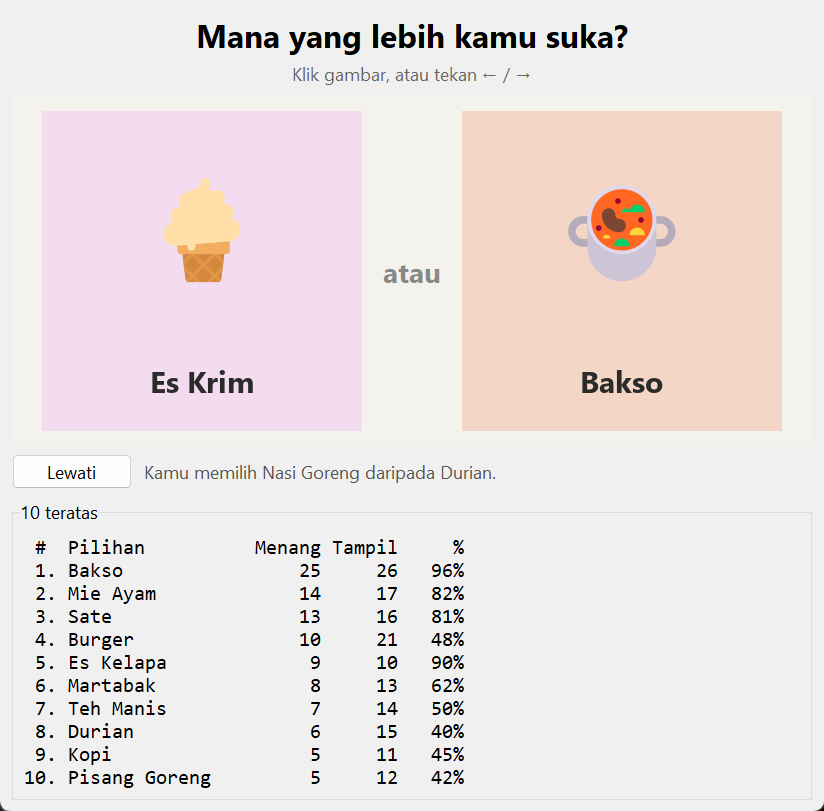

# This or That

Dua gambar muncul, pilih yang lebih kamu suka, lalu pasangan berikutnya tampil. Spesifikasi: [This or That Game](https://github.com/florinpop17/app-ideas/blob/master/Projects/2-Intermediate/This-or-That-Game.md).

Jendela Tkinter. Butuh `pillow` (`pip install pillow`).



Papan peringkat di screenshot diisi 120 suara dari "pemilih tiruan" di skrip uji.

## Menjalankan

```bash
python this_or_that.py                              # 16 kartu makanan dan minuman bawaan
python this_or_that.py --folder "C:/foto/kucing"    # pakai gambar sendiri
python this_or_that.py --top                        # papan peringkat di terminal
```

- **Memilih:** klik gambar yang kamu suka, atau tekan `←`/`→`. Pilihanmu diberi bingkai hijau, lalu pasangan baru meluncur masuk dari kedua sisi (animasi *ease-out*).
- **Lewati:** ganti pasangan tanpa memilih.
- **10 teratas:** jumlah menang, jumlah tampil, dan persentase menang.

## Gambar

- **Kartu bawaan:** digambar dari emoji berwarna dengan font Segoe UI Emoji milik Windows (Pillow, `embedded_color=True`), jadi tidak ada berkas gambar yang perlu diunduh.
- **Folder sendiri:** `--folder` membaca semua `.jpg`, `.png`, `.gif`, `.bmp`, dan `.webp`. Setiap gambar dipotong tengah menjadi persegi, dan nama berkasnya dipakai sebagai label.

## Pasangan dan suara

- **Pasangan:** semua item diacak lalu dipasangkan berurutan. Setelah semuanya tampil, item diacak lagi. Jadi setiap item tampil kira-kira sama sering (tes: selisih jumlah tampil paling banyak 4 dari 400 pasangan), sebuah item tidak pernah dipasangkan dengan dirinya sendiri, dan pasangan yang sama tidak muncul dua kali berturut-turut.
- **Suara:** setiap pilihan disimpan di SQLite (`~/.app-ideas-python/this-or-that.db`) sebagai pasangan (pemenang, yang kalah).
- **Peringkat:** diurutkan dari jumlah menang terbanyak. Kalau jumlahnya sama, persentase menang yang lebih tinggi didahulukan.

## Tes

```bash
python -m unittest -v
```

## Pemetaan user stories

- [x] Dua gambar tampil
- [x] Memilih gambar favorit dari keduanya
- [x] Setelah memilih, dua gambar lain tampil
- [x] Bonus: animasi halus saat gambar berganti
- [x] Bonus: suara disimpan di database
- [x] Bonus: papan peringkat 10 gambar dengan suara terbanyak
