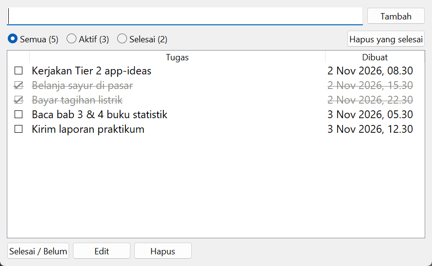

# To-Do App

Menambah, menandai selesai, mengedit, dan menghapus tugas. Datanya disimpan otomatis. Spesifikasi: [To-Do App](https://github.com/florinpop17/app-ideas/blob/master/Projects/2-Intermediate/To-Do-App.md).

Jendela Tkinter, hanya pustaka bawaan Python.



## Menjalankan

```bash
python todo.py
python todo.py --file tugas-kuliah.json     # daftar terpisah
```

- **Menambah:** ketik tugas lalu tekan `Enter` (atau **Tambah**).
- **Selesai:** klik kotak ☐ untuk menandai selesai, atau pilih tugas lalu tekan `Spasi`. Tugas yang selesai dicoret dan diberi warna abu-abu.
- **Edit:** klik dua kali judul tugas untuk mengeditnya langsung di baris itu. `Enter` menyimpan, `Esc` membatalkan.
- **Hapus:** tombol **Hapus** atau tombol `Delete`. **Hapus yang selesai** membersihkan semua tugas yang sudah selesai.
- **Filter:** **Semua**, **Aktif**, dan **Selesai**, masing-masing dengan jumlah tugasnya.
- **Tanggal:** tanggal dan jam pembuatan tampil di kolom **Dibuat**.

## Penyimpanan

Daftar disimpan di `~/.app-ideas-python/todo.json` setiap kali ada perubahan, jadi tetap ada saat aplikasi ditutup lalu dibuka lagi.

- **Aman saat penulisan terhenti:** berkas ditulis lewat berkas sementara lalu diganti (`os.replace`). Kalau program berhenti di tengah menulis, data lama tidak rusak.
- **Berkas rusak tidak ditimpa:** kalau berkasnya rusak, program menolak membukanya, supaya datanya tidak tertimpa daftar kosong.
- **Nomor tidak dipakai ulang:** nomor tugas tidak dipakai ulang setelah penghapusan.

## Tes

```bash
python -m unittest -v
```

## Pemetaan user stories

- [x] Kotak isian untuk mengetik tugas
- [x] Enter (atau tombol) menambahkan tugas ke daftar
- [x] Menandai tugas sebagai selesai
- [x] Menghapus tugas dengan tombol
- [x] Bonus: mengedit tugas
- [x] Bonus: daftar semua tugas yang sudah selesai
- [x] Bonus: daftar semua tugas yang masih aktif
- [x] Bonus: tanggal pembuatan tugas
- [x] Bonus: tugas tersimpan dan muncul lagi saat aplikasi dibuka kembali
