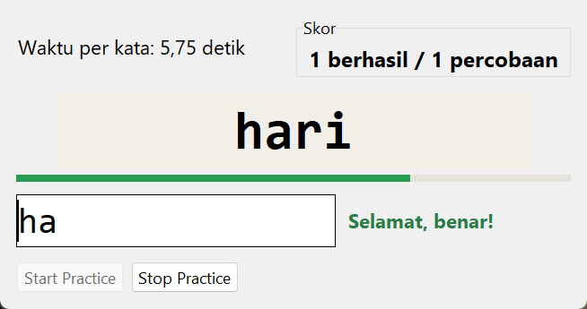
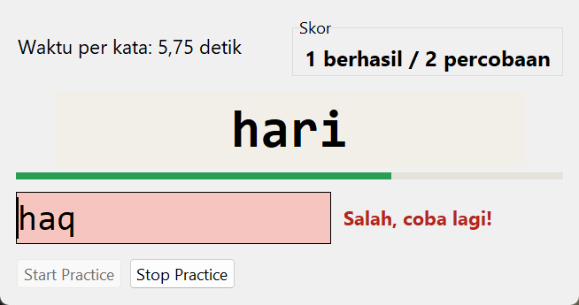

# Typing Practice

Ketik kata yang muncul sebelum waktunya habis. Makin sering benar, makin singkat waktunya. Spesifikasi: [Typing Practice](https://github.com/florinpop17/app-ideas/blob/master/Projects/2-Intermediate/Typing-Practice-App.md).

Jendela Tkinter, hanya pustaka bawaan Python.

| Sedang mengetik | Huruf salah |
| --- | --- |
|  |  |

## Menjalankan

```bash
python typing_practice.py
```

Tekan **Start Practice**, lalu ketik kata yang tampil di kotak besar.

- **Kata benar:** muncul ucapan selamat, dan **berhasil** serta **percobaan** di kotak skor bertambah. Waktu per kata berkurang 0,25 detik (dari 6 detik, minimal 1,5 detik), lalu kata baru muncul.
- **Huruf salah:** huruf yang sudah diketik berkedip merah lalu dikosongkan, pesan **"Salah, coba lagi!"** muncul di samping kotak isian, dan **percobaan** bertambah. Katanya tetap sama, jadi bisa dicoba lagi.
- **Waktu habis:** bilah di bawah kata berubah dari hijau ke kuning lalu merah. Kalau waktunya habis, dihitung sebagai satu percobaan gagal, lalu kata baru muncul.
- **Stop Practice:** menghentikan sesi dan menampilkan persentase jawaban benar.

Huruf besar dan kecil tidak dibedakan. Daftar katanya berisi sekitar 150 kata bahasa Indonesia sehari-hari, dan kata yang sama tidak muncul dua kali berturut-turut.

## Bunyi

Bunyinya dibuat sendiri sebagai berkas WAV saat program dimulai, lalu diputar dengan `winsound` (Windows):

- **Kata baru:** bip pendek 660 Hz.
- **Kata benar:** akor naik (G–B–E).
- **Huruf salah:** dua nada rendah yang sumbang.

Tes memeriksa bahwa ketiga berkas WAV valid dan berbeda satu sama lain. Saat pengujian jendela, pemutar bunyinya diganti dengan pemutar tiruan, jadi bunyinya sendiri belum didengarkan.

## Tes

```bash
python -m unittest -v
```

Logika sesi (kelas `Session`) memakai jam yang bisa diganti, jadi tes waktu habis tidak perlu menunggu.

## Pemetaan user stories

- [x] Batas waktu per kata tampil di jendela
- [x] Kotak skor berisi jumlah percobaan berhasil dan total percobaan
- [x] Tombol Start Practice untuk memulai
- [x] Kata yang harus diketik tampil di kotak teks
- [x] Mengetik kata di kotak isian
- [x] Huruf yang sudah diketik berkedip dan kotak isian dikosongkan kalau ada huruf salah
- [x] Pesan "coba lagi" di samping kotak isian kalau ada huruf salah
- [x] Total percobaan bertambah
- [x] Ucapan selamat kalau kata diketik dengan benar
- [x] Batas waktu berkurang sedikit setiap kali kata benar
- [x] Jumlah berhasil bertambah kalau kata benar
- [x] Tombol Stop Practice untuk berhenti
- [x] Bonus: bunyi berbeda untuk kata baru, kata benar, dan huruf salah
