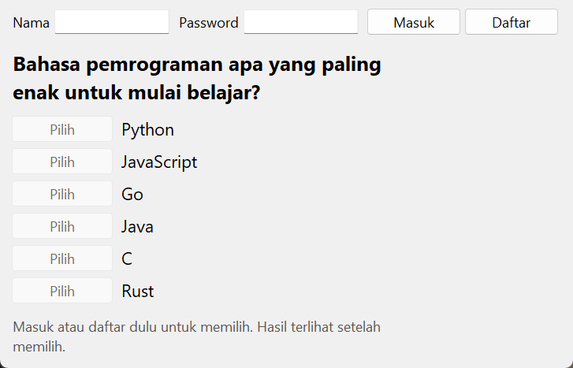
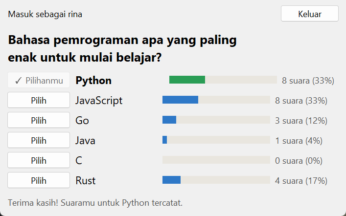

# Voting App

Daftar pilihan dengan tombol suara. Hasilnya baru terlihat setelah kamu memilih. Spesifikasi: [Voting App](https://github.com/florinpop17/app-ideas/blob/master/Projects/2-Intermediate/Voting-App.md).

Jendela Tkinter, hanya pustaka bawaan Python (SQLite, `hashlib`, `secrets`).

| Belum masuk | Setelah memilih |
| --- | --- |
|  |  |

Suara di screenshot berasal dari 23 akun tiruan yang dibuat skrip uji.

## Menjalankan

```bash
python voting.py                        # jendela
python voting.py --results              # hasil di terminal
python voting.py --add-item "Kotlin"    # tambah pilihan
```

1. **Masuk atau daftar:** isi nama pengguna dan password, lalu tekan **Masuk** (atau **Daftar** untuk akun baru). Sebelum masuk, tombol **Pilih** tidak aktif.
2. **Memilih:** klik **Pilih** di samping salah satu pilihan. Setelah itu hasil semua suara muncul berupa diagram batang dan persentase, dengan pilihanmu ditandai hijau.
3. **Ganti pilihan:** setiap akun punya satu suara, tetapi boleh diganti. Klik **Pilih** di pilihan lain.

Contoh keluaran `python voting.py --results`:

```
Bahasa pemrograman apa yang paling enak untuk mulai belajar?

Python      #######                8 (33.3%)
JavaScript  #######                8 (33.3%)
Rust        ###                    4 (16.7%)
Go          ##                     3 (12.5%)
Java        #                      1 ( 4.2%)
C                                  0 ( 0.0%)

Total 24 suara
```

## Database dan keamanan

Semua data disimpan di SQLite (`~/.app-ideas-python/voting.db`) dalam tiga tabel: `items`, `users`, dan `votes`.

- **Satu suara per akun:** dijamin oleh database itu sendiri, karena `user_id` adalah kunci utama tabel `votes`. Mengganti pilihan memakai upsert (`ON CONFLICT DO UPDATE`).
- **Password:** tidak disimpan apa adanya, melainkan sebagai hash **PBKDF2-SHA256** (200.000 putaran) dengan salt acak 16 byte per akun. Dua akun dengan password sama tetap punya hash berbeda.
- **Login gagal:** pesannya sama untuk nama yang salah maupun password yang salah, dan waktu prosesnya juga dibuat sama. Dengan begitu tidak bisa ditebak nama pengguna mana yang terdaftar.
- **Aturan akun:** nama pengguna 3–20 karakter (huruf kecil, angka, titik, garis bawah). Password minimal 8 karakter dan tidak boleh sama dengan nama pengguna.

Catatan: ini autentikasi lokal di satu komputer. Kalau aplikasinya dipakai bersama lewat internet, perlu server, HTTPS, dan pembatasan percobaan login.

## Tes

```bash
python -m unittest -v
```

## Pemetaan user stories

- [x] Daftar pilihan yang bisa dipilih
- [x] Setiap pilihan punya tombol untuk memilih
- [x] Setelah memilih, semua hasil suara terlihat
- [x] Bonus: pilihan dan suara disimpan di database
- [x] Bonus: hanya pengguna yang sudah masuk yang bisa memilih
